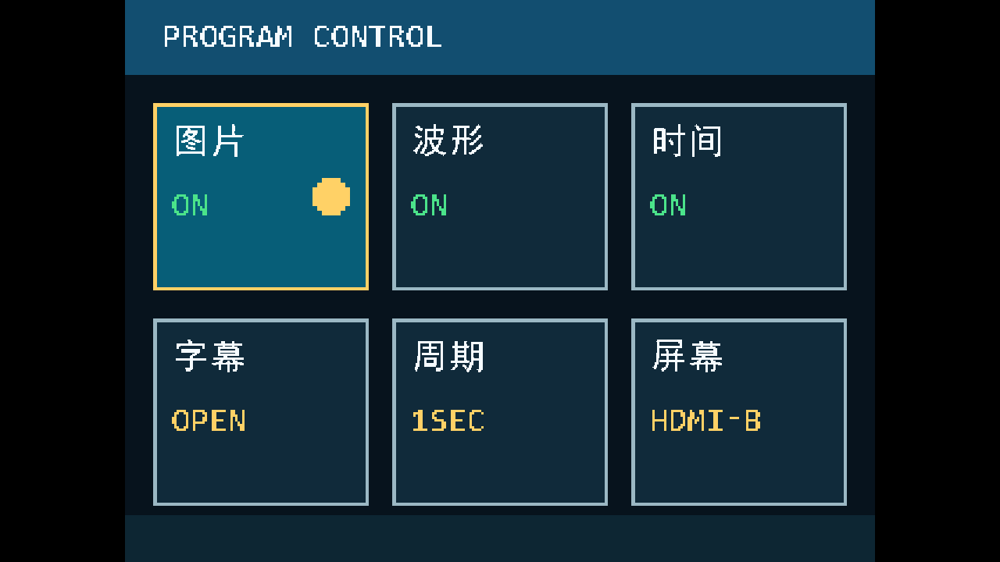
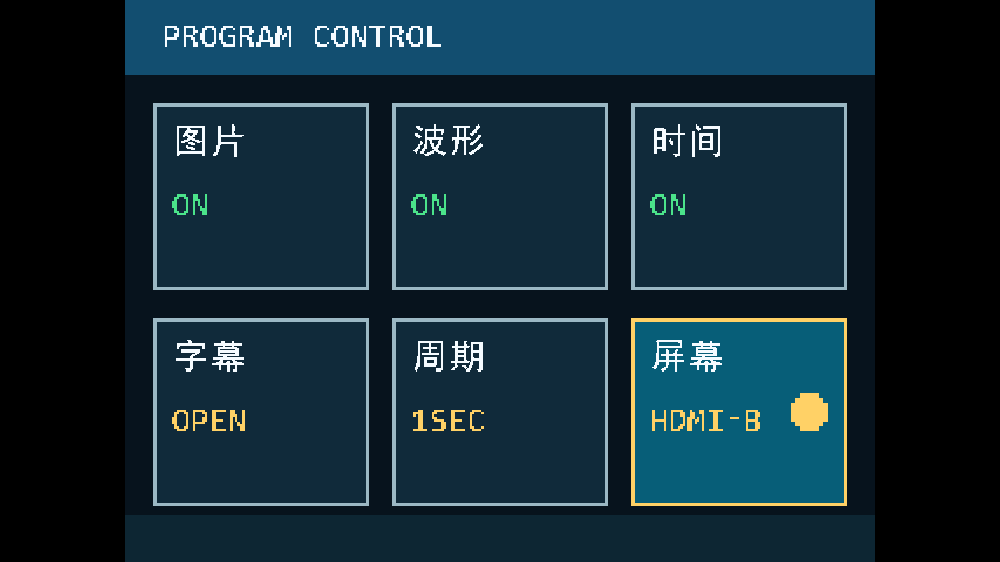
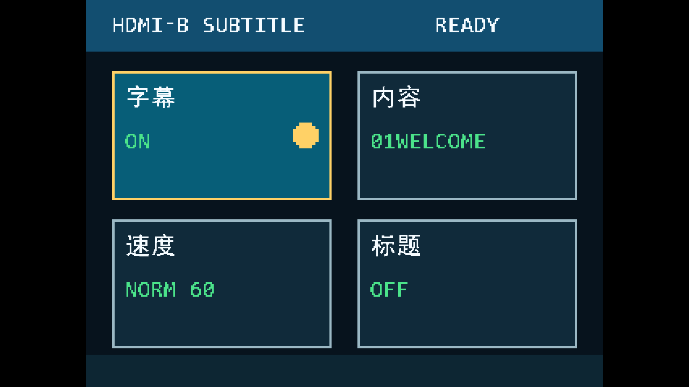
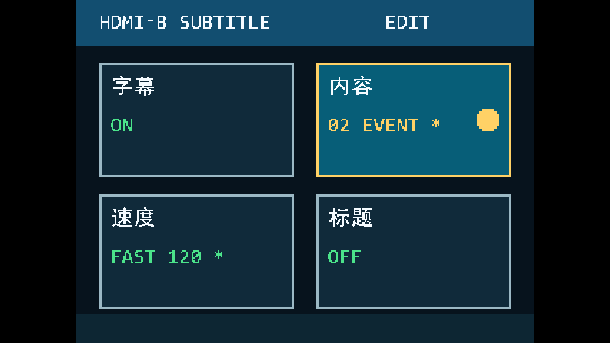
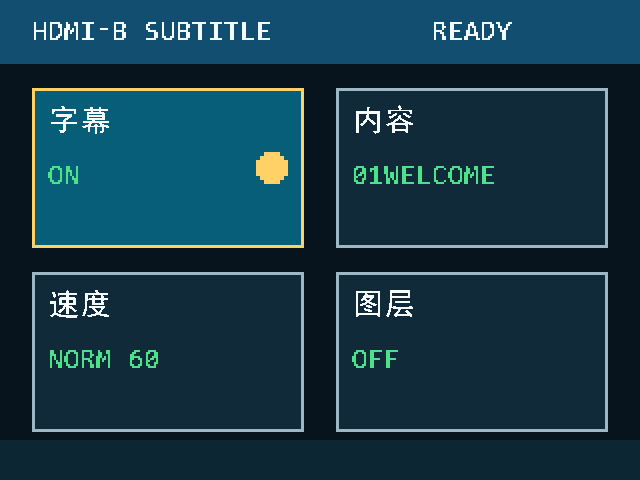
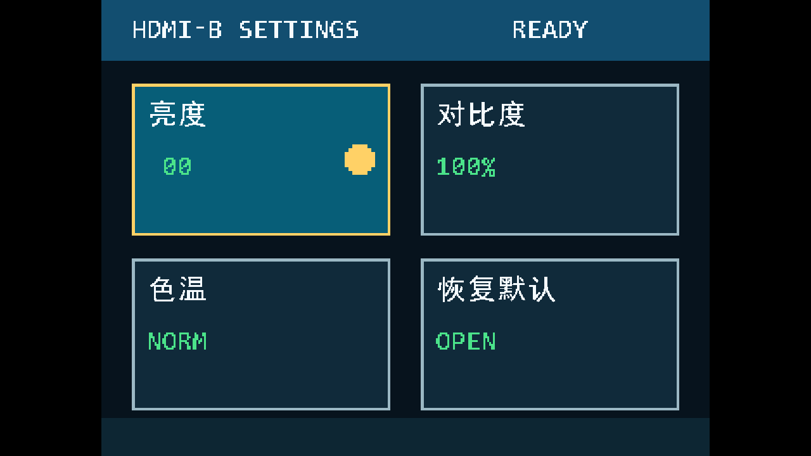
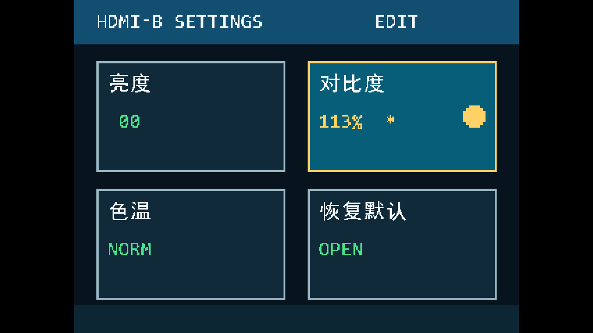
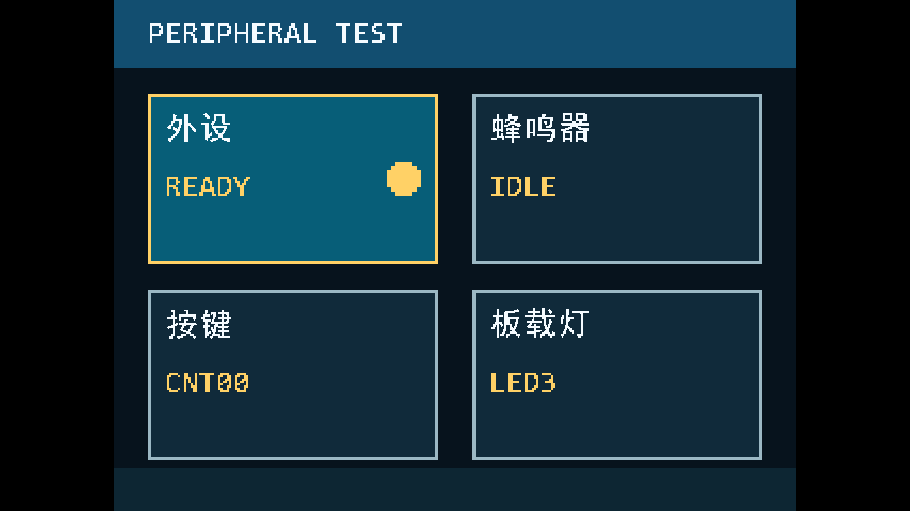
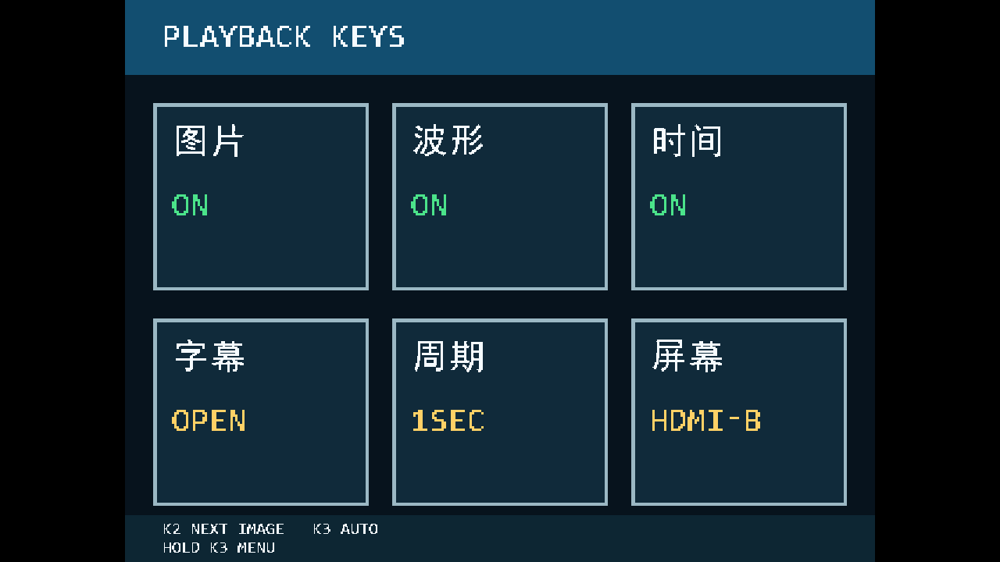

# 炬屏—双模HDMI多媒体系统：UI现状与外部审美评审报告

日期：2026-10-21。来源类型：本机RTL、字库生成脚本、仿真像素输出与既有完整构建报告。

本报告用于让设计智能体了解真实界面，再提出可落地的视觉改进。它是现状说明和评审输入，不是要求立即修改工程的实施单。

## 1. 版本与证据边界

| 内容 | 当前状态 |
|---|---|
| 已有完整构建版 | `releases/20261021-preset-subtitle/av_media.bit`，包含六卡菜单、二级屏幕设置与预设滚动字幕 |
| 已有bit SHA256 | `d23b57a95832bc495678556cb34280770719a576be76b46499aae94a826fe6f4` |
| 本轮已修改源码 | 固定标题/模式改天蓝色，运行时间改黄绿色；字幕页“图层”改“标题” |
| 本轮验证 | 5/5定向回归通过；菜单字库可重生成；新旧字库bank容量相同 |
| 本轮尚未完成 | 新配色及改名尚未做完整TD综合、P&R与bitgen，不能把既有bit当作本轮新程序 |
| 字幕文案状态 | 用户暂选“视界”和A组文案，随后决定交给其他AI再构思；当前RTL仍保留“通知”和旧三条文案 |
| 截图性质 | 菜单与字幕细条来自RTL仿真；720p菜单图按顶层真实坐标映射复现；照片合成图单独标为视觉参考，不是板拍 |
| 未知项 | 7寸屏物理有效像素、缩放模式、观看距离、屏幕色彩表现未重新实测，不能从“7寸”推断分辨率 |

菜单快照使用测试场景，展示不同选中/编辑状态；其中ON/OFF、图片数量和数值是测试输入，不保证等于上电默认值。

## 2. 产品定位与评审目标

作品名称为**炬屏—双模HDMI多媒体系统**。HDMI-B给观众看图片、音频波形、运行时间和滚动字幕；HDMI-A给操作者选择节目功能、调整主屏图片参数和查看外设状态。

用户希望界面现代、清楚、整齐，能在7寸屏上直接读懂。目标是让已有功能呈现得更像完整产品，而不是堆更多信息或极限压榨硬件。评审重点是信息层级、布局、中文排版、颜色语义、状态反馈和两屏品牌一致性。

| 已确认的偏好 | 对设计的影响 |
|---|---|
| 保留主菜单两行三列，六卡对齐 | 优先在现有结构上优化间距、层级和状态表达 |
| 控制菜单底部两行小号英文提示已被用户要求移除 | 不要原样重新放回“K2 PREV”等密集小字 |
| 需要明显选中反馈 | 保留或优化黄色边框与右部内缩圆点，不能只依赖细微底色变化 |
| HDMI-B标题/时间不能被照片背景淹没 | 已先改亮色；需进一步评估复杂明亮背景下的可读性 |
| 主屏“屏幕”设置调整HDMI-B | HDMI-A自身菜单配色不随亮度/对比度/色温参数改变 |
| 暂不扩展应急页面 | 应急显示只作为必须保持的功能边界，不把本次设计重心转向应急 |

## 3. 两屏尺寸与坐标口径

| 对象 | 当前实现 |
|---|---|
| HDMI-A线缆输出 | 标准1280×720、60Hz，与HDMI-B复用视频时钟及串行时钟 |
| HDMI-A逻辑菜单 | 640×480，4:3画布 |
| HDMI-A可见菜单区域 | 逻辑画布放大1.5倍至960×720，居中显示；左右各160个黑像素 |
| HDMI-A真实采样 | `logical_x=floor((output_x-160)*2/3)`，`logical_y=floor(output_y*2/3)`，只在x∈[160,1120)绘制 |
| HDMI-B节目区域 | 原生1280×720，不使用上述菜单坐标映射 |
| 本报告坐标 | 除明确标注HDMI-B/物理输出外，菜单布局尺寸均为640×480逻辑坐标；矩形区间均左闭右开 |

1.5倍菜单放大采用像素重复，字模列会重复1或2次；它不是平滑矢量字体。若建议改为原生720p菜单、改变画布比例或映射方式，须列为独立工程方案评估，不应当作换几个颜色即可完成。

## 4. HDMI-A主菜单：节目控制

逻辑排列：

| 左列 | 中列 | 右列 |
|---|---|---|
| 图片：显示图片开关 | 波形：PCM曲线开关 | 时间：运行时间开关 |
| 字幕：进入字幕二级页 | 周期：1/2/5/10秒 | 屏幕：进入HDMI-B图片参数页 |

| 布局元素 | 当前数值与样式 |
|---|---|
| 页眉 | y∈[0,64)，深蓝底；“PROGRAM CONTROL”位于x=32、y=16 |
| 卡片尺寸 | 184×160；x起点24/228/432，y起点88/272 |
| 卡片间隔 | 水平20，垂直24；主内容左右留24 |
| 卡片中文标题 | 左上内边距16；32×32原生字模；常见两字宽64 |
| 卡片状态 | local_x=16，local_y=72；8×16 ASCII字体放大2倍至16×32；最多10字符窗口 |
| 边框 | 3逻辑像素宽，直角，无阴影 |
| 选中圆点 | 32×32；范围local_x∈[card_w-48,card_w-16)，local_y∈[64,96)；距右边16 |
| 圆点轮廓 | 8×8常量圆形位图放大4倍，为填充圆点，存在像素台阶 |
| 底部 | y∈[440,480)深色条；菜单激活时无两行小号按键文字 |

默认从“图片”卡片开始；主菜单三项普通开关初始开启，固定标题初始关闭，滚动字幕初始关闭，周期初始档位1秒。按键是上一项/下一项线性循环，按从左到右、从上到下的顺序导航，不能当作方向键或触摸屏。

## 5. HDMI-A字幕二级页

| 左列 | 右列 |
|---|---|
| 字幕：ON/OFF | 内容：01WELCOME / 02 EVENT / 03 MEDIA |
| 速度：SLOW 30 / NORM 60 / FAST 120 | 标题：固定标题与模式文字ON/OFF |

本轮右下卡片已从“图层”更名为“标题”。上图反映的是本轮源码仿真，旧bit中仍显示“图层”。

| 元素 | 当前规则 |
|---|---|
| 页眉 | “HDMI-B SUBTITLE”；右侧显示READY / EDIT / WAIT |
| 四卡尺寸 | 272×160；x起点32/336，y起点88/272；水平间隔32 |
| 中文标题 | 两字、64×32；卡内偏移16、16 |
| 状态字段 | 16×32 ASCII，10字符窗口，最长宽160 |
| 焦点 | 黄色边框、黄色圆点、青蓝底色 |
| 编辑中 | 当前编辑卡片状态数值变为黄色；未编辑状态值统一绿色 |
| 未确认变化 | 值后用星号`*`标注；不等于HDMI-B已生效 |

**目前“字幕OFF”和“标题OFF”也可能用绿色显示。** 这不是开启状态的可靠颜色标识，建议评审给出更统一的开/关/禁用/编辑/待确认颜色规则。

内容名字目前是英文编号，没有中文整句预览。可评估更短的中文分类名或内容摘要，但须考虑新增字形数量、卡片空间及实际渲染成本。

### 原发布版对照

这张图为原发布包截图，只用于对照“图层”名称；其余当前截图来自本轮定向仿真。

## 6. HDMI-A屏幕设置二级页

| 左列 | 右列 |
|---|---|
| 亮度 | 对比度 |
| 色温 | 恢复默认 |

| 参数 | 当前显示及范围 |
|---|---|
| 亮度 | -64至+64，步长16，9档 |
| 对比度 | 50%至150%，步长12.5%，以整数百分比显示，例如112.5%显示113% |
| 色温 | COOL / NORM / WARM |
| 恢复默认 | OPEN；编辑时RESET，确认后恢复中性参数 |
| 页眉 | HDMI-B SETTINGS，右侧READY / EDIT / WAIT |

版式复用四卡布局。中文最长是“恢复默认”四字，逻辑宽128；“对比度”三字宽96。默认文字值绿色，编辑值黄色。当前没有滑杆、档位刻度、中文参数说明或连续数值动画。参数只处理HDMI-B的底图，后叠加的文字、波形和应急色保持各自颜色。

## 7. HDMI-A外设页与播放按键模式

| 左列 | 右列 |
|---|---|
| 外设：TF初始化READY/WAIT | 蜂鸣器：IDLE/TEST |
| 按键：事件计数简写 | 板载灯：LED加十六进制状态 |

当前仅蜂鸣器卡片KEY4会触发约200ms测试，其他三卡是状态显示，不能把“能选中”宣传成“均可控制”。蜂鸣器显示的是FPGA请求状态，不是麦克风检测到的实际声音。

TF卡片主要显示初始化；板载灯卡片显示4位内部驱动状态十六进制编码。初始化阶段四灯全亮，之后分别表达心跳、显示有效、近期音频有效、应急或SD超时等状态。当前UI没有逐灯图例，没有完整TF/FAT/错误数诊断表，也没有把数码管单独列成控制卡片。提出改进时须区分排版优化与新增诊断功能。

退出菜单后仍保留卡片，但没有活动选中框，页眉为PLAYBACK KEYS。底部重新出现两行8×16英文播放提示，这是单独的播放按键模式；**两个控制菜单页仍无底部小字**。可评估是否改成更清晰的大号模式反馈，但不要把旧的小字菜单说明重新加回。

## 8. HDMI-A完整色板及使用语义

| 颜色角色 | HEX | 使用位置 |
|---|---|---|
| BG | `#07131D` | 页面背景、卡片间隙 |
| HEADER | `#124E70` | 页眉 |
| CARD | `#102A3A` | 未选中卡片填充 |
| CARD_SEL | `#075E78` | 已选中卡片填充 |
| FG | `#F5FBFF` | 中文标题与常规页眉文字 |
| MUTED | `#9BB8C4` | 未选中边框 |
| ON | `#4BE38A` | 主菜单开启值、二级页常规状态值 |
| OFF / WARN | `#FF756C` | 主菜单关闭值、存在预览时的非选中卡片边框 |
| ACCENT | `#FFD166` | 选中边框、圆点、编辑值和入口值 |
| FOOTER | `#0D2633` | 底部背景条 |
| 外部留边 | `#000000` | 1280×720输出中的左右黑边 |

需要特别评审三种语义冲突：黄色同时表示焦点、编辑和入口；绿色同时表示“开启”和普通数值/OFF；红色同时表示关闭与待确认预览。当前`cfg_dirty`会让所有未选中卡片边框变为警示红，而非仅标记有变化的卡片。

当前没有接入真正的确认闪烁或勾选动画；虽然渲染器有`commit_seen`输入，实际像素生成没有使用它。现有反馈主要是边框、圆点、填色、星号及READY/EDIT/WAIT文字。评审若建议新增动画，应明确帧计数、周期、持续时间与可见状态，不能描述为已经实现。

## 9. HDMI-B节目画面：布局、字号与配色

| 元素 | 原生720p位置 | 字号/颜色 | 当前行为 |
|---|---|---|---|
| 背景图片 | 等比适配到1280×720，必要时补边 | RGB565存储，展开为RGB888 | 可开关，可调亮度/对比度/色温 |
| 固定标题 | x=32，y=32；14字格，448×32 | 原生32×32；本轮源码天蓝`#38BDF8` | “炬屏—双模HDMI多媒体系统” |
| 模式文字 | x=1120，y=32；128×32 | 同标题配色 | 常规为“广告模式”，与标题同一开关 |
| 运行时间 | x=896；字幕关闭时y=656，开启时y=80；352×32 | 本轮源码黄绿`#C8F75A` | “运行 HH:MM:SS”，独立开关 |
| 音频波形 | x∈[128,1152)，y∈[576,672) | 主线`#20FF90`，中轴`#406060` | 真实PCM时域曲线，不是FFT频谱 |
| 峰值条 | x∈[1160,1168)，波形区域内 | `#FFB020` | 随音频峰值变化 |
| 图片关闭背景 | 全节目底图区域 | 中性色彩参数下为`#07131D` | 视频时序继续，其他叠加层可保留 |

原发布bit中的标题/时间仍为黑色；新颜色已过像素检查，但尚未生成新bit。当前只有文字笔画，没有描边、阴影或固定标题底板。亮色能改善部分照片背景，但不能保证在所有明亮、花纹复杂的图片上都有足够对比度。可评估轻量深色底板或其他低成本处理，并分清“必要”与“可选”。

字幕关闭时，时间区域y∈[656,688)与波形区域底部y∈[656,672)有16像素交集，OSD后绘制会覆盖该处曲线；这也是可供设计评审重新组织右下角空间的现状。字幕开启后时间移至右上，二者不再这样重叠。

### 配色与照片叠加参考

以下两图由现有RGB565照片、真实32px ROM字形、仿真波形像素及当前布局合成，用于评估明暗背景上的信息可读性；**不是板拍，也不是新bit整帧输出记录**。第二图仍使用旧“通知”和旧欢迎语，因为新文案尚未定稿。

## 10. HDMI-B底部滚动字幕条

| 部分 | 当前原生像素规格 |
|---|---|
| 外框/底条 | x∈[32,1248)，y∈[672,712)，尺寸1216×40；底部留8 |
| 底条背景 | 对原画面R/G/B分别右移1位，约50%变暗，不是模糊玻璃效果 |
| 固定标签底色 | x∈[32,144)，深蓝`#124E70` |
| 标签文字 | “通知”，从x=48开始，y∈[676,708)，32px原生字模 |
| 滚动正文窗口 | x∈[160,1232)，y∈[676,708)；左右不越过标签与边距 |
| 装饰线 | 顶边y=672及左侧4像素，青色`#38BDF8` |
| 字色 | 标签与正文均为近白`#F5FBFF` |
| 圆角/阴影 | 无，当前为直角矩形和细线 |
| 滚动方向 | 正文从右向左；固定标签不动 |
| 速度 | 约30/60/120像素每秒，对应60Hz时序 |
| 循环 | 32字格×32px=1024px循环，剩余格为空白；字符超过32格无法直接放入现有格式 |
| 动画提交 | 只在帧事件推进；改内容/速度或重新开启时从可读起点重新开始 |

旧三条正文为：

1. 欢迎体验双屏多媒体系统
2. 活动正在进行 欢迎参与体验
3. 图片 音乐 字幕 精彩呈现

上面细条来自1280×48区域仿真，底图是测试固定颜色，不代表真实照片。它们能说明边距、字号、标签与正文关系，不能证明任意实物观看距离下都易读。

用户暂选的新方案：固定标签“视界”；第一句“炬屏—双模HDMI多媒体系统”，第二句“双屏协同 视听同步”，第三句“图片 音乐 字幕 精彩同屏”。这只是外部构思的起点，并未写入当前字库。

## 11. 字体与硬件预算

| 项目 | 真实约束 |
|---|---|
| 菜单中文 | 黑体`simhei.ttf`以30号光栅化进32×32、1bpp字格；本轮36个实际字形 |
| 菜单字库bank | 1024×32基础bank＋128×32扩展bank；本轮复用原层字槽与空闲槽改“标题”，容量不变 |
| 菜单ASCII | 8×16像素字体；标题/数值通常放大2倍，播放页底部提示使用原8×16 |
| 主屏中文及字幕 | 32×32、1bpp，现有55个字形；统一2048×32同步ROM，最多64格 |
| 字形扩充 | 不看句子总长度，而看所有固定文字/数字/候选字幕合并后的不同字符数；允许替换旧句后重新压缩字集，不必永久保留被删除的旧字 |
| 半透明效果 | 现在用RGB逐通道除2；固定比例变暗、简单边框可低成本实现 |
| 可以优先考虑 | 调色、留白、对齐、文本精简、少量静态图形、帧计数闪烁、有限档位条 |
| 需要单独评估 | 多字号独立字库、完整矢量字体、模糊/大阴影、多层透明材质、原生720p菜单重排 |
| 不应默认要求 | 新增大帧缓存、大量纹理图片、更多PLL或大范围字体全库 |

最近完整构建的资源是旧发布版数据，不能视为本轮新颜色源码已综合后的结果：

| 资源 | 已使用/总量 | 比例 |
|---|---|---|
| LUT | 14875/19600 | 75.89% |
| 寄存器 | 9315/19600 | 47.53% |
| BRAM9K | 57/64 | 89.06% |
| BRAM32K | 4/16 | 25.00% |
| DSP | 13/29 | 44.83% |
| PLL | 3/4 | 75.00% |

工程既有BRAM9K预算上限90%，继续优先复用字库和逻辑绘制。本轮新配色没有增加流水级，菜单没有增加ROM字数容量；实际物理资源与时序仍须完整构建确认。最近完整构建的视频setup仅+0.262ns，说明不能在像素路径随意串接复杂几何、长加减链或多层字库选择。旧加密SDRAM跨域全局setup负余量另行记录，不能以此豁免新增UI路径。

## 12. 不应破坏的交互语义

| 场景 | 当前交互 |
|---|---|
| 主菜单导航 | KEY2上一项，KEY3下一项，按线性顺序循环 |
| 普通主菜单开关/周期 | KEY4首次改预览，再次确认；周期预览按1/2/5/10秒循环 |
| 进入字幕/屏幕 | 对应卡片KEY4进入二级页 |
| 二级页 | KEY4进入编辑，KEY2减小/关、KEY3增大/开，KEY4确认 |
| 取消/返回 | KEY2长按约1秒：取消编辑→返回主菜单→退出菜单恢复切图，逐层操作 |
| 切页 | 主菜单KEY3长按约1秒切节目/外设；二级页则返回主菜单 |
| 播放按键模式 | KEY2下一图片，KEY3自动轮播，KEY3长按返回菜单 |
| 应急 | 任意页面KEY4长按约2秒仍保留应急功能；不得误触发短按确认 |
| 确认生效 | HDMI-A显示预览，HDMI-B在帧边界应用；WAIT期间不能覆盖正在提交的配置 |

审美改进应使“已选中”“正在编辑”“尚未确认”“已应用”“已关闭”容易区分。若建议修改操作步骤，请另外列出，不要在纯视觉优化中悄悄改变用户已经熟悉的按键逻辑。

## 13. 请外部评审重点回答的问题

| 维度 | 需要的具体建议 |
|---|---|
| 整体风格 | 怎样形成“炬屏”的简洁视听控制台气质，避免像调试工具或密集参数表？ |
| 页面层级 | 页眉、卡片标题、值、焦点和模式状态应如何分配视觉权重？ |
| 配色 | 给出一套角色清晰的HEX色板；解释绿色、黄色、灰色、警示色的用途，检查典型前景/背景对比度 |
| 布局 | 在既有640×480逻辑画布内，给出可直接实现的坐标、边距、卡片大小、文字基线；不要混用720p坐标 |
| 中文与英文 | 哪些英文值得中文化？如何避免新增过多字形？如何精简READY/EDIT/WAIT和内容名称？ |
| 焦点与反馈 | 圆点尺寸/内缩是否合适？怎样区分焦点与编辑？是否需要低成本确认反馈？ |
| 主节目叠加 | 标题、模式、运行时间、波形和滚动条怎样不抢图片主体、不互相遮挡？ |
| 字幕条 | 固定标签是否必要？“视界”是否合适？条高、文字位置、背景变暗、品牌识别如何协调？ |
| 文案 | 基于作品名称给出多组三句组合，第一句明确作品身份，第二句表达双屏协作，第三句表达视听体验 |
| 实施顺序 | 每项标P0/P1/P2和低/中/高成本，先做低风险且观感提升最大的项目 |

请不要只写“高级感、科技感、优化间距”。每项建议要指明当前问题、具体改法、像素/色值/状态规则和预期效果。若提供效果图，应附可实施的布局表；效果图中的虚构按钮、触控和高成本光效不能代替工程规格。

## 14. 证据文件与后续交付

| 来源 | 用途 |
|---|---|
| `rtl/video/monitor_menu_renderer.v` | 卡片、页眉、颜色、选中标识、文案和状态色 |
| `rtl/top/top_tf_hdmi_audio.v` | 720p输出与640×480逻辑映射、主屏图层顺序和波形位置 |
| `rtl/video/osd_engine_720.v` | 主屏文字、时间、字幕区域与颜色 |
| `scripts/gen_monitor_cjk.py` | 菜单中文的字形索引与ROM容量 |
| `scripts/gen_font_720.py` | 作品标题、三条正文、主屏字集与字格限制 |
| `rtl/ctrl/monitor_menu_ctrl.v` | 三按键交互、预览/确认/取消 |
| `rtl/video/promax_audio_waveform.v` | 曲线、中轴、峰值配色 |
| `releases/20261021-preset-subtitle/resource_summary.json` | 最近完整构建的资源证据 |
| `validation_5_tests.json` | 本轮定向验证状态；不是全量75项新一轮验证 |
| `SOURCE_SHA256.json` | 本报告对应源码的字节哈希 |

请将外部智能体的建议、选择理由、配色表、布局表和字幕候选原样返回；再由工程侧检查字库、资源、像素路径时序与按键兼容性，确定实施范围后修改。用户尚未选择最终文案前，当前字幕正文保持不变。
