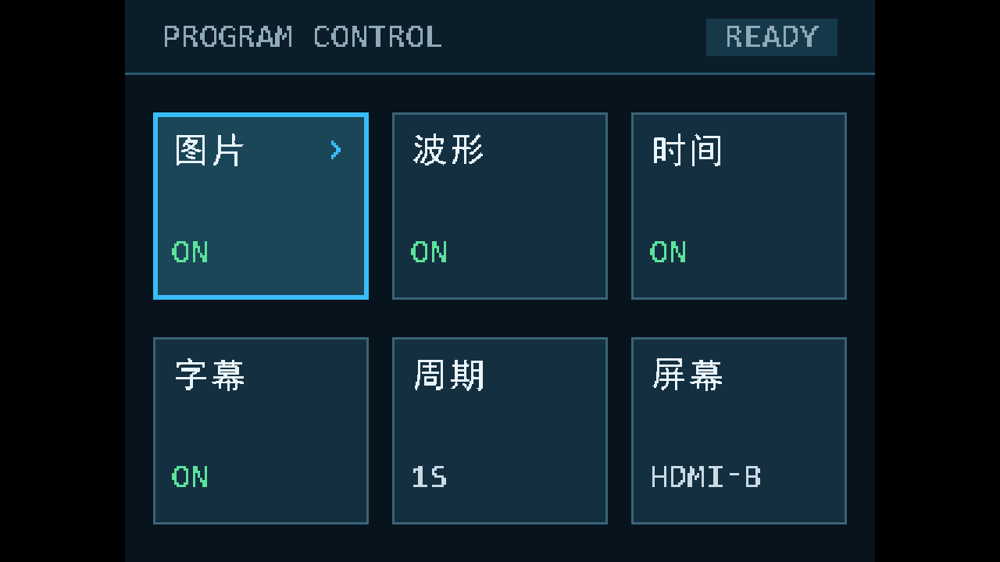
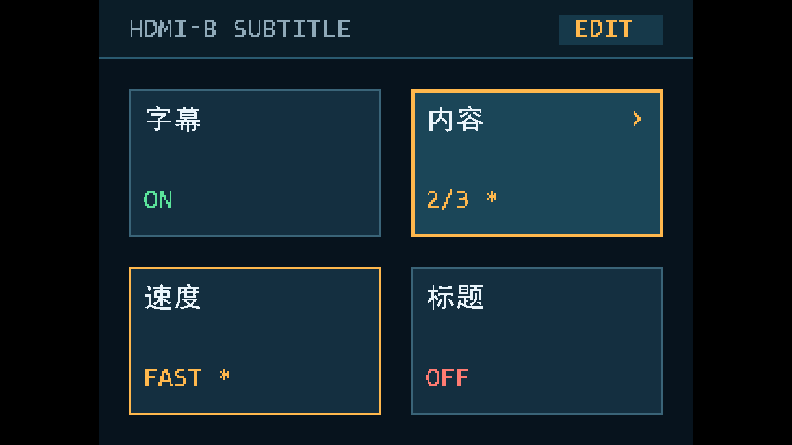
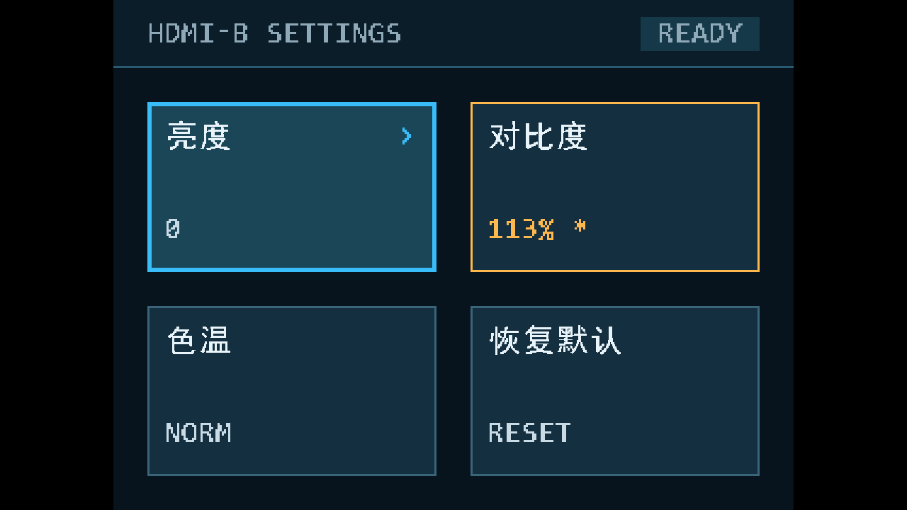
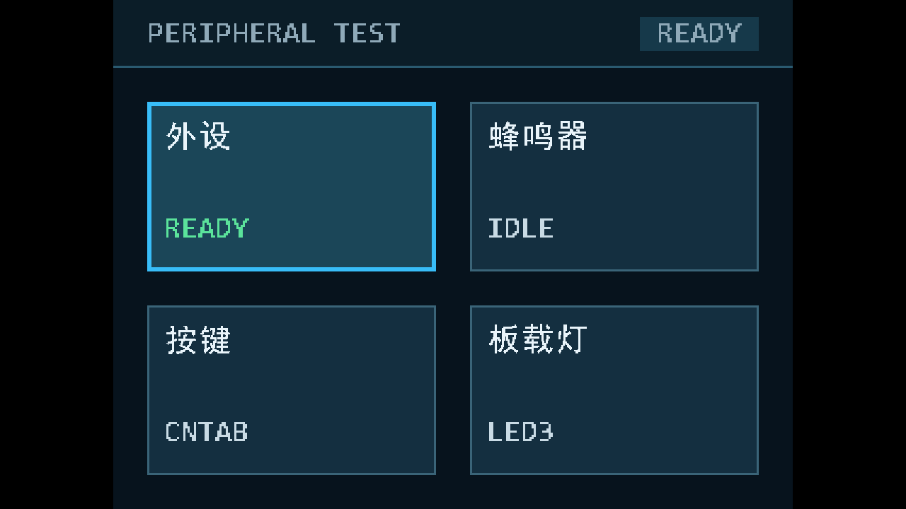
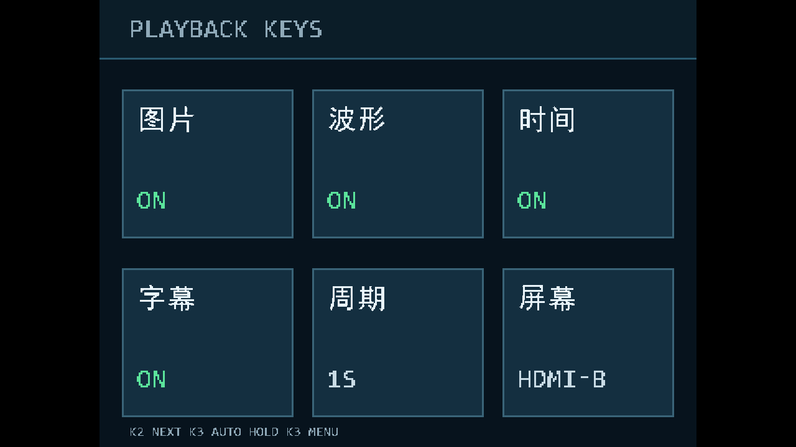
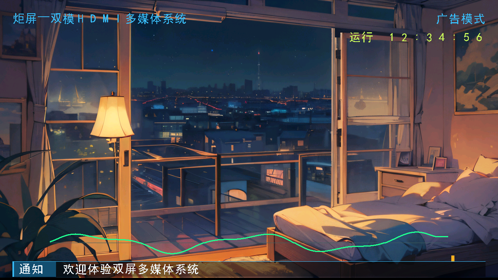
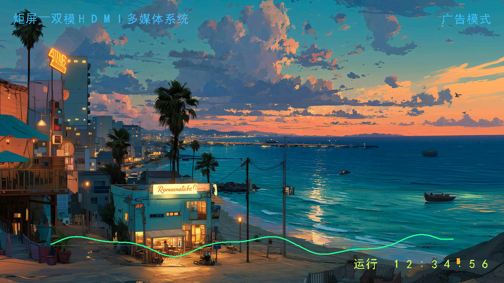

# 炬屏—双模HDMI多媒体系统：当前工程与UI详细审查说明

核对日期：2026-10-22（北京时间）。工程根目录：`D:\FPGA\code\example`。分支：`feat/key2-next-prefetch`。

**这是一份现状说明与外部AI审查输入，不是修改RTL的指令。当前任务只整理说明、截图和证据。**

## 1. 先澄清：为什么字幕看起来完全没改

用户观察正确。最新烧录文件完成的是设计方案 §8.1–8.5 的 **HDMI-A菜单P0**，以及播放提示留白、EDIT状态两项复审修复。方案 §8.6（HDMI-B布局）和 §8.7（滚动文案与主屏字库）没有实施；生成新bit不意味着整个设计方案都已实施。

| 对象 | 当前实际状态 | 不能误读成什么 |
|---|---|---|
| HDMI-A字幕设置页 | 已更新卡片网格、颜色、焦点、箭头、值格式、pending标记；右下名称为“标题” | 不代表HDMI-B滚动条样式或正文改变 |
| HDMI-B固定标题/模式文字 | 天蓝 `#38BDF8`，已随本次完整构建进入新bit | 不代表新增顶部标题底板 |
| HDMI-B运行时间 | 黄绿 `#C8F75A`，已随本次完整构建进入新bit | 不代表已经固定到方案建议的新位置 |
| 滚动条固定标签 | **仍是“通知”** | “视界”尚未替换 |
| 滚动正文 | **仍是旧三条预设**，见第9节 | 未换成作品名称及新宣传文案 |
| 主屏布局与波形 | 保留原位置、40px字幕条、峰值竖条 | 未实施48px新字幕条、时间固定右下或删峰值条 |

本说明替代旧 `D:\FPGA\code\example\docs\ui-review-20261021\REPORT.md` 的“当前状态”口径。旧报告是10月21日快照，其中黄色圆点、旧坐标、旧状态值和“未构建新bit”等描述已过时。原设计方案仍是设计意图，不能作为已实现证据。

## 2. 当前版本、发布与证据

| 项目 | 核对结果 |
|---|---|
| 最新发布bit | `D:\FPGA\code\example\build\720p\releases\20261022-menu-ui-p0\av_media.bit` |
| SHA256 | `1bf3e751daa910d08c1220406b2a91dfb9f18defb78e7da823c502be2905aee7` |
| 最终物理构建日志 | `D:\FPGA\code\example\build\720p\td\20261022-menu-ui-p0-final` |
| 完整功能回归 | 75/75 PASS；complete=true，filter=null；未变化项按依赖哈希复用 |
| 真正重跑的本轮变化项 | 菜单渲染10整页像素参考、真实顶层菜单相位检查 |
| 独立菜单核验 | 10场景、48卡全部边框；常规/聚焦四侧为3/6输出像素；14项受保护输入哈希一致 |
| 当前板验边界 | 用户已经烧录观察到字幕仍旧；未收到本版所有功能、长稳和实物可读性逐项验收记录 |
| 断电启动与设置保存 | bit生成不等于Flash固化；当前菜单参数复位恢复默认，不包含参数断电保存 |
| 本说明证据 | 本机RTL、生成脚本、构建/回归记录、现有仿真图；不是本轮重新做完整赛题审计 |

`evidence/SOURCE_SHA256.json` 保存本说明对应源码快照的哈希；`evidence/verification.json` 保存本轮文档交付核验。`source_snapshot/` 只用于只读审查，不是完整可独立构建的工程。

## 3. 系统做什么：面向使用者与答辩的说明

“炬屏”的使用场景是双屏媒体展示：观众屏显示图片、WAV音频、PCM波形、时间和预设滚动字幕；操作者屏负责开关图层、调整播放周期、调节图片色彩和查看部分外设状态。两路HDMI由一块FPGA输出。

| 功能 | 当前能力与边界 |
|---|---|
| 图片输入 | TF卡FAT32根目录BMP索引，最多8张；BMP24、无压缩、正高度，源尺寸宽1..1280/高1..720 |
| 图片显示 | SDRAM双显示页，RGB565存储，HDMI-B输出RGB888；低资源最近邻等比适配720p，必要时补边 |
| 多尺寸 | 640×480/800×600→960×720、两侧各160px补边；1280×720铺满；奇数宽处理支持，实测范围不能无限外推 |
| 切图 | 手动下一张、自动轮播、下一图预取与转场；冷热缓存、读卡和转场使真实可见间隔不同于周期数字 |
| 音频 | 已有WAV→PCM→HDMI音频链路，用户此前确认音频/WAV可用；不是通用音频格式播放器 |
| 可视化 | 真实PCM时域波形与峰值条；**不是FFT频谱** |
| 图层控制 | 图片、波形、时间独立开关；字幕页另有滚动字幕和固定标题开关 |
| 屏幕参数 | HDMI-A选择，作用于HDMI-B底图的亮度、对比度、色温；不调整HDMI-A菜单 |
| 外设页 | TF初始化、蜂鸣器测试、按键计数简写、LED状态；没有完整诊断仪表盘 |
| 应急 | 保留独立视频覆盖、警笛与蜂鸣器优先路径；用户暂不要求扩展应急UI |
| 字幕输入 | 三条编译期预设；无任意UTF-8文件加载、串口输入、键盘编辑或逐图字幕绑定 |

WAV实现仍有固定44字节头、预期PCM/48kHz/16bit/双声道和连续扇区装载的约束；原始扇区扫描不能被描述成完善的FAT文件播放。用户当前素材可用是板验事实，格式泛化与碎片支持是另一项工程任务。本轮仅记录边界，不改音频链路。

## 4. 数据、时钟与图层架构

```text
TF/FAT32/BMP → RGB565源暂存 → 最近邻等比缩放 → SDRAM显示双页
                                                    ↓
HDMI-B：图片/诊断底色 → 色彩调节 → PCM波形 → OSD/滚动字幕 → 应急覆盖 → HDMI视频/音频

按键 → 100MHz菜单控制器 → shadow预览 / payload提交 → toggle/ACK邮箱
                            ↓                       ↓ VS应用
HDMI-A：独立720p时序 → 640×480逻辑坐标 → 菜单字库/逻辑绘制 → TMDS
```

| 关键点 | 现有实现 |
|---|---|
| 两路视频 | HDMI-A/B均输出1280×720@60Hz，复用video_clk与hdmi_5x_clk；HDMI-A为DVI兼容纯视频，无音频 |
| 帧缓存带宽 | HDMI-A菜单只用逻辑绘图和字库，不额外读SDRAM图片帧缓存 |
| 配置提交 | 菜单正文payload保持到ACK；视频域同步toggle，在VS消隐复制cfg/screen/subtitle正文 |
| 预览与生效 | HDMI-A显示shadow，HDMI-B只用active；退出/取消按现有控制器恢复预览 |
| 预览CDC边界 | 预览及部分诊断值经采样同步供监视显示，不应说所有多位诊断值都是原子状态快照；正式节目配置由邮箱提交保护 |
| 像素相位 | 菜单坐标缩放、字库读取、最终输出寄存与HS/VS/DE三拍对应；不能仅延迟RGB而不延迟时序 |
| 波形样本 | 使用真实PCM有效事件；HDMI空FIFO静音包不能冒充新的PCM采样 |
| 选择按键 | 物理KEY2/3/4，在RTL顶层对应历史命名key1/key2/key3；审查时先核对实例连接，别按变量名猜板号 |

本轮参考老师 `brand_watermark_24.v`、`subtitle_scroll_24.v` 的窄位宽地址、同步字模与命中对齐做法，进一步把每卡8位字符先并行选出，再选择卡片。实际目标是缩短字库地址关键路径；**不是声称本轮总LUT减少**。老师水印例程有条件读ROM，本工程采用无关区可读取、输出按同拍命中屏蔽，二者不能混说。

## 5. 坐标与字体口径：避免再次误判“压扁”

| 对象 | 尺寸及映射 |
|---|---|
| HDMI-A线缆时序 | 1280×720@60Hz，实际输出不是640×480 |
| HDMI-A逻辑画布 | 640×480，4:3 |
| HDMI-A物理可见区 | 960×720居中，x[160,1120)，左右各160黑边 |
| 采样公式 | lx=floor((px−160)×2/3)，ly=floor(py×2/3)；超出可见区为黑 |
| 中文 | 原生32×32、1bpp黑体字格；HDMI-A放大后每格48×48，笔画本身不一定填满字格 |
| 菜单ASCII值/页眉 | 8×16基础字形放大2倍为16×32逻辑像素，输出24×48 |
| 播放提示 | 8×16逻辑像素，输出12×24，唯一保留的小号提示 |
| HDMI-B中文/字幕 | 原生32×32输出像素，不经过HDMI-A的1.5倍映射 |

本说明菜单坐标默认是640×480逻辑坐标；HDMI-B坐标始终为原生1280×720。矩形使用左闭右开区间。1.5倍是像素重复，列/行会交替重复1或2次；不是抗锯齿矢量排版。不能将逻辑坐标直接拿到主屏使用。

## 6. HDMI-A当前网格、字号与颜色

### 6.1 网格与几何

| 元素 | 当前逻辑坐标/尺寸 | 720p输出对应 |
|---|---|---|
| 页眉 | y[0,64)，分隔线y[62,64) | 高96、分隔线3px |
| 页名 | x32，y16，16×32 ASCII格 | x208，y24 |
| 状态块 | x[496,608)，y[16,48)；文字x[512,592) | x[904,1072)，y[24,72) |
| 主菜单六卡 | 184×160；x24/228/432，y96/288 | 276×240；x196/502/808，y144/432 |
| 四卡二级/外设页 | 272×160；x32/336，y96/288 | 408×240；x208/664，y144/432 |
| 六卡间隔 | 横20，竖32；左右24 | 横30，竖48；画布内左右36 |
| 四卡间隔 | 横32，竖32；左右32 | 横48，竖48；画布内左右48 |
| 中文标题 | 卡内x16、y16，32×32字格 | 距卡片左/上24输出像素 |
| 值/状态 | 卡内x16、y104，16×32 ASCII格，10字符窗口 | x方向总窗口240px |
| 常规/聚焦边框 | 内缘2/4逻辑像素 | 四侧统一3/6输出像素 |
| 选中动作标识 | `>`箭头；六卡local_x[148,164)，四卡[236,252)，local_y[16,48) | 已删除旧黄色圆点；仅可执行KEY4动作的聚焦卡显示 |
| 菜单页底部 | y[448,480)仅背景 | 没有旧白色英文操作说明，也没有旧底部色带 |
| 播放模式底部 | 单行x[32,288)、y[456,472) | 卡片底边与提示、提示与画布底各留12输出像素 |

播放提示实际字符串是 `K2 NEXT K3 AUTO HOLD K3 MENU`，可见28字符；字符串存储补空白到32字符，窗口按32格预留256逻辑像素。不要沿用旧复审中的“30字符/240px”估算。

### 6.2 当前色板

| 角色 | HEX | 语义 |
|---|---|---|
| BG | #07131D | 页面与卡间背景 |
| HEADER | #0B1D28 | 页眉底色 |
| RULE | #2A5A70 | 页眉分隔线 |
| SURF | #142F40 | 常规卡片 |
| SEL | #1B4658 | 聚焦卡片底色 |
| FRAME | #3A6478 | 常规细框 |
| FG | #E9F4FA | 中文标题 |
| VALUE | #C9DBE5 | 普通数值/只读状态 |
| MUTED | #8FA9B8 | 页名、READY、播放提示 |
| FOCUS | #38BDF8 | 选择框、非编辑箭头 |
| ON | #5BE39B | 已开启、TF READY、蜂鸣器TEST |
| OFF | #FF7B72 | OFF及ERR；错误另有明确ERR文本 |
| AMBER | #FFB84D | 编辑、待确认、WAIT |
| CHIP | #16394A | READY/EDIT状态块底色 |
| WAIT_FG | #16232B | WAIT琥珀实底上的深色字 |
| DIS | #6E8593 | 预留色，当前无实际禁用状态，不要伪造已支持“禁用卡片” |

### 6.3 状态反馈优先级

| 状态 | 实际显示 |
|---|---|
| 聚焦、未编辑 | 青色粗框、选中底色；有动作才显示青箭头 |
| 聚焦、编辑中 | 琥珀粗框/箭头，值为琥珀 |
| 未聚焦、待确认 | 只有该卡变琥珀细框；值为琥珀并带星号，不再整页变色 |
| 普通ON/OFF | 薄荷绿/珊瑚红；待确认优先用琥珀表示状态 |
| 页眉WAIT | 提交忙优先，琥珀底深色字；不保证保持人眼可见的最短时长 |
| 页眉EDIT | 当前聚焦卡有pending，或二级页处于edit；不用全局cfg_dirty |
| 页眉READY | 当前聚焦卡无pending且非edit、非busy；不保证别的卡没有待确认变化 |

目前没有勾选动画、确认闪光、光标闪烁或WAIT延时保持。`commit_seen`虽接入渲染器，当前没有对应确认动画。不要把建议写成已实现效果。

## 7. HDMI-A四个页面与播放模式

### 7.1 节目控制（上电直接进入）

| 顺序 | 卡片 | 当前值格式 | KEY4行为 |
|---|---|---|---|
| 0 | 图片 | ON/OFF | 普通开关两次按键预览/提交 |
| 1 | 波形 | ON/OFF | 同上 |
| 2 | 时间 | ON/OFF | 同上 |
| 3 | 字幕 | ON/OFF，反映滚动字幕shadow | 进入字幕二级页，不是直接切换字幕开关 |
| 4 | 周期 | 1S/2S/5S/10S | 预览下一档，再次确认 |
| 5 | 屏幕 | HDMI-B | 进入屏幕设置 |

复位默认：图片/波形/时间ON；固定标题OFF；滚动字幕OFF；周期1S。默认值不等于测试截图输入：截图可故意开启字幕或预设待确认状态。



### 7.2 字幕设置（调整的是HDMI-B）

| 位置 | 卡片 | 当前值/作用 |
|---|---|---|
| 左上 | 字幕 | ON/OFF，底部滚动条总开关 |
| 右上 | 内容 | 1/3、2/3、3/3；当前没有中文整句预览或内容摘要 |
| 左下 | 速度 | SLOW/NORM/FAST，对应30/60/120px每秒（60Hz） |
| 右下 | 标题 | ON/OFF，仅控制固定作品标题与模式文字；不控制时间、波形或滚动字幕 |

内容与速度到边界停止，不循环跳档；修改需要确认。`cfg_active[3]`的产品含义现在是“标题”，不是泛指全部视觉图层。



### 7.3 屏幕设置（只影响HDMI-B底图）

| 卡片 | 档位/显示 | 中性默认 |
|---|---|---|
| 亮度 | −64..+64，步长16；零档仍显示0 | 0 |
| 对比度 | 50%..150%，实际步长12.5%；显示整数为50/63/75/88/100/113/125/138/150% | 100% |
| 色温 | COOL/NORM/WARM | NORM |
| 恢复默认 | RESET；进入该动作编辑后CONFIRM | 确认后恢复中性参数 |

屏幕正文默认10'h144；参数在VS生效。波形、OSD和应急在后级叠加，保持自己的颜色；图片关闭时的诊断底色仍经过色彩调节，因此不能保证调参后底色还严格为#07131D。



### 7.4 外设页

| 卡片 | 值 | 实际能力 |
|---|---|---|
| 外设 | READY/WAIT | 显示TF初始化信号；不是完整TF/FAT扫描、错误计数面板 |
| 蜂鸣器 | IDLE/TEST | KEY4触发约200ms短测；应急优先；显示请求而非声音传感器反馈 |
| 按键 | CNTxx | xx取key_events[15:8]的十六进制；低8位不显示，少量按键时可能一直CNT00 |
| 板载灯 | LEDx | x为4位状态的十六进制；无逐灯图例、无手动开关 |

后三张只读卡中的“按键/板载灯”，以及“外设”卡，虽然可聚焦，KEY4无动作，因而不显示箭头。不能据可聚焦推断均可控制。

LED0每0.5s翻转心跳；LED1为display_valid；LED2是已发现WAV的锁存状态，**不是实时音量/有声检测**；LED3为应急或BMP/WAV SD超时。TF未初始化时四灯全亮。这次说明纠正了旧报告对LED2“近期音频有效”的不准确描述。



### 7.5 退出菜单后的播放按键模式

仍显示卡片，不回到旧参数页；取消活动选中框，页眉PLAYBACK KEYS，保留底部一行小号提示。此时KEY2切下一图、KEY3切自动播放；长按KEY3回节目控制。



## 8. 按键流程、提交语义与审查时要注意的交互

| 场景 | KEY2短按 | KEY3短按 | KEY4短按 | 长按 |
|---|---|---|---|---|
| 主菜单 | 上一项 | 下一项 | 普通项预览/确认，入口进入 | K2返回播放；K3切外设；K4应急 |
| 二级页非编辑 | 上一项 | 下一项 | 进入编辑 | K2返主菜单；K3取消并返主菜单；K4应急 |
| 二级页编辑 | 减/关 | 加/开 | 确认提交 | K2取消编辑；K3取消并返主菜单；K4应急 |
| 外设 | 上一项 | 下一项 | 仅蜂鸣器有短测 | K2返回播放；K3切节目；K4应急 |
| 播放模式 | 下一图 | 自动播放切换 | 无常规菜单确认 | K3返节目菜单；K4应急 |

KEY2/3菜单长按阈值约1秒，松手后分类发事件；菜单短按也在松手消抖后产生。KEY4应急由独立模块约2秒触发。按住KEY4超过1秒不足2秒可能既不产生菜单短按，也未达到应急，不能教成“任意长按都会确认”。每次长按返回后应松开再进行下一次。消抖20ms不等于图片装载等待。

### 8.1 普通开关示例

若没有其他待确认预览：选图片→KEY4预览OFF，菜单显示琥珀值/星号，HDMI-B暂不变→再按KEY4提交→下一帧消隐生效。重新开启同理再预览ON并确认。

### 8.2 当前存在但本轮没有改的全局事务行为

主菜单控制器用**全局cfg_dirty**决定KEY4是“第一次预览”还是“第二次提交”，视觉层则按逐卡pending显示。移动光标不自动取消主菜单预览。

例如：图片卡KEY4产生OFF预览→光标移到波形卡，页眉可能READY→此时KEY4会提交已有图片预览，**不会同时把波形切换**。这是当前代码路径可直接推导的交互，不是本轮新修复，也不能宣称每张普通卡都有独立编辑事务。

请外部AI评审是否需要更明确的“全局待提交”指示或调整流程；这应列为交互功能变更，不能混进纯调色。READY当前语义是“当前聚焦项无待确认”，不是“整个系统没有待确认”。

### 8.3 正式配置与取消

配置cfg四位为image/waveform/clock/title，字幕五位为{speed,preset,enable}，屏幕参数独立10位。共享toggle/ACK，忙时不覆盖在途正文；二级页可先继续预览，但提交仍受busy保护。进入二级页或长按翻页会按现有规则丢弃未确认预览，防止确认屏幕参数时顺带提交图片开关。

## 9. HDMI-B当前排版：滚动字幕的实际实现

### 9.1 各图层位置与配色

| 图层 | 720p原生坐标 | 当前样式 |
|---|---|---|
| 固定作品标题 | x[32,480)，y[32,64)，14格×32 | “炬屏—双模HDMI多媒体系统”，天蓝#38BDF8；无底板、描边或阴影 |
| 模式 | x[1120,1248)，y[32,64) | 广告模式/应急模式对应文字表；正常固定文字与标题共用开关，应急后级画面另有覆盖 |
| 时间，字幕关闭 | x[896,1248)，y[656,688) | “运行 HH:MM:SS”，黄绿#C8F75A；没有时间专用底板 |
| 时间，字幕开启 | x[896,1248)，y[80,112) | 自动移到右上，颜色不变 |
| PCM波形 | x[128,1152)，y[576,672) | 主线#20FF90，中轴#406060，连续时域曲线 |
| 峰值竖条 | x[1160,1168)，y在波形高度内随峰值变化 | 橙#FFB020，仍保留 |
| 字幕底条 | x[32,1248)，y[672,712)，1216×40 | 直角，正文底图RGB各通道>>1，约保留50%亮度 |
| 标签块 | x[32,144)，y[672,712) | 固定深蓝#124E70，不跟照片透明混合 |
| 标签文字 | x[48,112)，y[676,708) | “通知”，近白#F5FBFF，原生32px |
| 正文窗口 | x[160,1232)，y[676,708) | 近白#F5FBFF，原生32px，从右向左 |
| 装饰线 | 顶行y=672；左侧x[32,36) | 青#38BDF8 |

字幕条距屏幕左右32px、底部8px；文字上下各4px，首行装饰线占其中1px。字体没有新增高清字库，也没有低成本的自动对比度或按底图择色。





### 9.2 当前三条正文

| 菜单索引 | **当前RTL真正的句子** | 字格数（含空格） |
|---|---|---|
| 1/3 | 欢迎体验双屏多媒体系统 | 11 |
| 2/3 | 活动正在进行 欢迎参与体验 | 13 |
| 3/3 | 图片 音乐 字幕 精彩呈现 | 13 |


细条来自1280×48、y[668,716)的RTL测试，输入背景固定#84B6E8；不是照片、不是板拍。用例的有效依赖哈希未变化，因此完整回归复用其既有通过记录，不把这些细条说成本轮新跑出的照片整帧。

### 9.3 速度、循环与默认值

- 字幕默认cfg=0x08：关闭，预设1，正常速度；不是上电就有滚动文字。
- slow每两帧1px，normal每帧1px，fast每帧2px，60Hz下约30/60/120px每秒。
- 10位偏移自然回绕1024px，32格、每格32px；不足32格补空白，并非按每句话的实际长度连续首尾衔接。
- 初始scroll_origin=864，即−160模1024，正文起点x160从第0格可读显示；配置改变/关闭时复位，VS才推进。
- 正文窗口1072px大于1024px循环48px，因此相同周期的开头48px可在窗口末端再次可见。此为几何事实，不应一概误判成菜单重复渲染bug；是否美观应单列评审。
- 固定标题、时间、字幕三个开关相互独立，当前不存在“标题关导致字幕一起关”的设计要求。

### 9.4 当前待改善的观感

1. 固定标签仍“通知”、内容仍旧，缺少作品品牌表达。
2. 无顶部标题底板：天蓝/黄绿文字在明亮照片上仍可能不清晰。
3. 字幕关闭且时间开启时，时间y[656,688)与波形y[576,672)有16px垂直交集，且时间先后级关系使文字覆盖曲线；不是已经解决的布局。
4. 字幕开关会使时间从底部跳右上；审查是否希望位置固定。
5. 文字32高、条40高，边距紧；当前不是方案建议的48高条。
6. 半亮度底图在白照片上约#7F7F7F，近白文字对比度仍可能不足4.5:1；不能将“压暗”直接当可读性保证。
7. 波形、峰值条、字幕色彩并列，视觉重点偏多；是否去掉峰值条是未实施方案，不是现状。
8. HDMI-A只有1/3编号，操作者不知道下一条具体内容；增加预览需要字集、版式和控制审查。

## 10. 旧方案§8.6/§8.7：未实施清单与文案分歧

| 项目 | 当前实现 | 旧方案建议，**尚未实施** |
|---|---|---|
| 压暗比例 | RGB>>1 | RGB>>2，保留约25%亮度 |
| 顶部标题带 | 无 | 全宽y[0,72)底板；y[70,72)青线 |
| 标题 | y[32,64)，天蓝 | y[24,56)，#F2FAFF |
| 模式 | 天蓝，同原标题行 | #8FD5FA，跟新标题行 |
| 时间 | 字幕开关时上下跳位 | 固定文字x864、y[672,704)，底板x[848,1248)、y[664,712) |
| 字幕条 | y[672,712)，40px | y[664,712)，48px |
| 标签 | 通知；标签块至x144 | 视界；标签块x[32,128) |
| 正文 | x[160,1232) | x144起，时间开至832、关至1232 |
| 波形高度 | 96，结束y672 | 88，结束y664 |
| 波形主线/轴色 | #20FF90/#406060 | 主线2px、#3BF0A5；中轴#2A4E58 |
| 峰值条 | 保留 | 删除 |
| H/D/M/I字模 | 常规黑体字形落入32格，实际笔画较窄 | 横向拉宽到约24/32格再居中 |

同一时间板块与字幕板块相交时，方案要求只压暗一次；这是关键像素验收点。不能先画字幕减亮再对时间区域减亮一次。

### 文案有两个不同来源，需要外部AI明确比较

| 项 | 用户此前暂选 | 外部设计方案§8.7 |
|---|---|---|
| 标签 | 视界 | 视界 |
| 第一句 | 炬屏—双模HDMI多媒体系统 | 相同 |
| 第二句 | **双屏协同 视听同步** | **双屏协作 一屏操作 一屏呈现** |
| 第三句 | 图片 音乐 字幕 精彩同屏 | 相同 |

两版第二句不同，不能写成“用户已经最终确认同一句”。本轮不替用户选文案，也不把候选写进ROM。请审查风格、信息量、展示场景与字数，推荐明确的一版或提出新组，返回可执行方案。

## 11. 字库、资源预算与可做程度

| 字库 | 当前配置 |
|---|---|
| HDMI-A中文 | 32基础＋4扩展，共36字；1024×32与128×32两个bank；simhei.ttf，30号落入32格，1bpp |
| HDMI-A ASCII | 8×16基础字形，常规放大2倍；不含完整中文输入功能 |
| HDMI-B共享OSD字库 | **55单元（含空白）**，32×32、1bpp；2048×32同步ROM，64单元容量 |
| 当前所有字幕 | 均≤32字格，来自gen_font_720.py；只改单个显示字符串而不重建映射会错字 |
| 按旧方案重新压缩字集 | 新三句＋视界＋标题/模式/时间/数字并集为**50单元（含空白）** |
| 按用户此前暂选重新压缩字集 | 并集为**47单元（含空白）** |

50和47是对当前生成脚本相同字集算法做的只读计算，不是重新生成或烧录结果。必须替换旧句后重建并集才有这个数量；保留全部旧新用字会得到不同计数。64单元仍是当前物理容量，不因候选较少就自动减少BRAM块。

| 最终物理资源 | 已用/总量 | 比例 |
|---|---|---|
| LUT | 15022/19600 | 76.64% |
| 寄存器 | 9371/19600 | 47.81% |
| BRAM9K | 57/64 | 89.06% |
| BRAM32K | 4/16 | 25.00% |
| DSP | 13/29 | 44.83% |
| PLL | 3/4 | 75.00% |

| 当前路径 | setup / hold余量 |
|---|---|
| video_clk | +0.184 / +0.024 ns |
| hdmi_5x_clk | +0.962 / +0.049 ns |
| ext_mem内部 | +0.143 / +0.022 ns |
| 全局hold | +0.022 ns |
| 旧加密SDRAM跨域全局setup | **−6.565 ns，单独保留，不能称全工程时序闭合** |

本版满足菜单P0视频setup≥0.15ns、BRAM9K≤57的门限。资源足够不代表可以随意串更深的像素组合逻辑；新修改仍须重新验证。优先调色、静态几何、留白、精简文案、复用字库，避免新帧缓存、新PLL、整套多字号字库、模糊和大面积纹理。两屏已经由单板运行，不能仅因UI美化就默认要求第二块板。

## 12. 应重点审查的缺口：区分观感、交互与新功能

| 优先级建议 | 问题/待决定项 | 类型 | 当前证据 |
|---|---|---|---|
| 优先审查 | 主屏字幕仍旧；是否按§8.6/8.7或修订方案执行 | 主屏设计待实施 | 当前源码与生成脚本文字、坐标均直接可查 |
| 优先审查 | 时间/波形16px重叠、时间跳位、明亮照片上的文字对比 | 排版/可读性 | 区域相交与合成顺序可查；实屏观感需补 |
| 优先审查 | 第二句存在两个候选来源 | 文案决策 | 第10节明确列出 |
| 建议审查 | 菜单READY的局部语义与全局提交事务 | 交互可理解性 | 第8.2节具体操作路径；不能当成纯换色 |
| 建议审查 | 内容编号没有正文预览 | 信息层级/可选功能 | 当前1/3，未实现中文摘要 |
| 建议审查 | 播放模式小提示在7寸屏是否仍偏小 | 板级可读性 | 12×24输出字格，尚无新板拍逐项记录 |
| 可选 | 按键低次数看不到、LED十六进制难读 | 诊断语义/功能 | CNT取高8位、LED状态可查 |
| 暂缓 | 完整TF/FAT/欠载/PLL/数码管诊断页 | 新诊断功能 | 当前菜单未实现；已有内部信号不等于UI已接入 |
| 暂缓 | 任意字幕输入、逐图音频绑定、FFT、第二板 | 新系统能力 | 不属于本轮UI整理，应单独立项评估 |

这里不是重新宣判哪些赛题条款未完成。旧赛题审计早于屏幕设置/滚动字幕，有些条目已经过期；需要正式合规复核时应重新读取题目原文，不能照抄旧欠缺表。720p符合用户明确的分辨率理解，不能因题目提到640就倒退改成640输出。

## 13. 请外部AI按此格式返回审查结果

1. **事实核对表**：分别写“已实现、未实施、需要源码/实屏进一步确认”，指出旧报告/方案中的过时项。不要先改代码。
2. **主屏/字幕问题表**：每项给具体区域、失败场景、像素坐标、颜色、字数、建议优先级和预计资源风险。
3. **菜单复审表**：只评当前P0，不拿旧黄色圆点截图当现状；重点看七寸可读性、READY/EDIT/WAIT语义与主菜单全局事务。
4. **文案候选**：至少比较第10节两组；第一句保留作品全名，每句≤32字格，建议≤24；明确空格、破折号、HDMI大小写、是否保留固定标签。
5. **实施规格**：菜单640×480逻辑、HDMI-B1280×720两套坐标分开；给矩形左闭右开范围、字体格、层级、色值、开关组合和裁剪规则。附美图不能代替规格。
6. **落地与验收**：列出需要修改的确切源文件/测试，必须覆盖标题/时间/字幕8种开关组合、明暗照片对比、循环裁剪、VS推进、相位及完整P&R。
7. **停止点**：只交付审查报告/修订方案，等用户将方案带回工程实施；不要修改RTL、字库、约束、TD数据库或bit，不运行烧录，不提交Git。

不要只写“科技感、高级感、优化间距”。每项建议应能落到坐标、字形、颜色与状态机。输出工程状态时，不以效果图、源码存在、旧PASS或用户单项可用结论替代完整验收。

## 14. 审查用源码路径与阅读顺序

以下是**原工程绝对路径**；打包给无法访问本机的AI时，可读同名 `source_snapshot/` 快照。

| 顺序 | 文件 | 重点 |
|---|---|---|
| 1 | `D:\FPGA\code\example\rtl\video\monitor_menu_renderer.v` | 当前网格/色板/值格式/箭头/状态，不是旧圆点 |
| 2 | `D:\FPGA\code\example\rtl\ctrl\monitor_menu_ctrl.v` | 上电菜单、物理键、全局dirty、确认/取消与二级页 |
| 3 | `D:\FPGA\code\example\rtl\ctrl\monitor_config_regs.v` | payload保持、toggle、VS提交与预览 |
| 4 | `D:\FPGA\code\example\rtl\top\top_tf_hdmi_audio.v` | 两屏实例、坐标缩放、波形/颜色/OSD/应急顺序与LED |
| 5 | `D:\FPGA\code\example\rtl\video\osd_engine_720.v` | 当前主屏标题、时间、滚动底条、半亮度、同步字库 |
| 6 | `D:\FPGA\code\example\scripts\gen_font_720.py` | 当前旧三句/通知、55单元、32字格、生成目标 |
| 7 | `D:\FPGA\code\example\rtl\video\subtitle_text_720.v` | 编译期每格字形索引，不是运行时文本文件 |
| 8 | `D:\FPGA\code\example\rtl\video\promax_audio_waveform.v` | 曲线、轴、峰值条、采样/发布 |
| 9 | `D:\FPGA\code\example\scripts\gen_monitor_cjk.py` | 36字、32×32、基础/扩展bank |
| 10 | `D:\FPGA\code\example\sim\tb_subtitle720.v` | 当前字形索引/旧文案参考、循环、速度、颜色；换字集后参考也需审核 |
| 11 | `D:\FPGA\code\example\sim\tb_monitor_menu_renderer.v` | 当前10整页像素参考与状态切换 |
| 12 | `D:\FPGA\code\example\sim\tb_monitor_pipeline.v` | 真实顶层缩放、三拍相位、3/6px边框 |
| 13 | `D:\FPGA\code\example\scripts\check_menu_p0.py` | 10场景/48卡、播放留白、14输入保护 |
| 14 | `D:\FPGA\code\example\docs\ui-review-20261021\proposal\UI_DESIGN_PROPOSAL.md` | 设计意图，§8.6/8.7尚未实施；不是现状 |

`evidence/CODE_LOCATIONS.json`提供核对本版关键符号时自动提取的行号和原行内容；行号只对本次快照有效。老师参考根目录为 `D:\FPGA\micu_FPGA_lesson\选题一完赛参考工程代码\米醋电子工作室忧郁完赛参考工程\topic1_student_reference`，重点是 `project_code\rtl\display\brand_watermark_24.v` 与 `subtitle_scroll_24.v`；借鉴技术方法不等于复制老师UI。

## 15. 本轮整理的验证与交付边界

本轮将回读新报告引用、图片尺寸、快照哈希、当前源码/bit清单以及压缩包CRC。没有为编写说明而重跑耗时完整仿真或TD；报告中的75项和时序是当前发布包已完成的证据。未改变RTL、生成字库、时钟约束、工程入口或烧录文件。

菜单图是RTL栅格按真实1.5倍映射；字幕细条是当前算法的有效历史RTL输出；照片主屏图是单独标注的软件合成参考；旧方案效果图是未实施的设计参考。**四者必须区分，不能互相冒充。**

离线HTML与Markdown内容一致；审查提示词见同目录 `REVIEW_PROMPT.txt`；证据、快照与图片随 `D:\FPGA\code\example\docs\UI_REVIEW_20261022.zip` 打包。原10月21日评审包与本次bit发布包保留原样。
