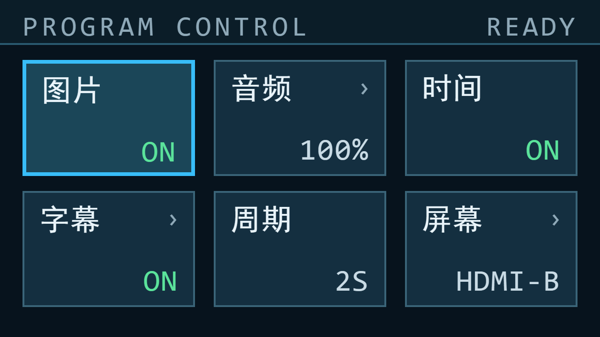

# 当前双 HDMI UI 严格审美审查

审查者／日期：外部 UI 审美评审（Oil UI 方向探索流程），2026-10-23
读取的基线：`docs/ui-review-20261023/` 资料包；源码快照哈希见 `evidence/SOURCE_SHA256.json` 与 `SHA256SUMS.txt`
限制：只审查与给规格，未改工程、未烧录、未声称新资源/时序结果。文中所有"提案"图均为 HTML 近似示意（系统字体、无 1bpp 栅格），不是 RTL 输出，也不是板拍。

---

## 1. 真实审美结论

**63/100，介于工程原型与成品之间：功能骨架完整，但视觉上还没有"被设计过"。**

三个最突出的问题：

1. **六块等大的框把"标签"和"数值"拉到了卡片两端**（标题 y16–48、值 y104–136，中间 56px 空），而六张卡的值各自左对齐，横向没有形成任何一列。眼睛无法快速把"图片"和"ON"配对，读起来像一张填了一半的表。
2. **ASCII 数值在大字格中偏细偏散**：中文 32×32 墨迹约 3–4px/48px 输出，ASCII 8×16×2 只有 2px/48px；三个列各自左对齐，右端参差（ON 结束于 268、100% 于 622、HDMI-B 于 976 输出坐标），横向没有形成一条数值线。
3. **HDMI-B 像贴了三张尺寸不同的黑标签**：标题板 480 宽、模式板 160 宽、字幕条 1216 宽、时间板 400 宽，左缘 16 与 32 两种边距、右缘 1264 与 1248 两种，时间文字左 16 右 32 不对称。

推荐方向（用户已选定）：**全幅 16:9**——逻辑画布 640×480 → 640×360，按 2 倍整数放大铺满 1280×720：黑边消失、1.5 倍非整数映射的笔画重复消失、同样的字模直接变成 64px。它一次解决三个结构性问题（黑边吃掉 25% 画幅、非整数映射的粗细不均、卡片里上下两条被拉太开）。清单化（六行）降为备选，见 §6.1 与 §11。

---

## 2. 事实核对和证据缺口

|项|源码/截图证据|确认当前现状|冲突或尚不能判断|
|---|---|---|---|
|实际双屏尺寸及黑边|`top_tf_hdmi_audio.v` 映射；`menu_*_720.png` 两侧 160px 黑；用户实测|HDMI-A 1280×720@60，640×480 逻辑 1.5× 居中，左右各 160 黑；HDMI-B 原生 1280×720。**面板为 7 寸 16:9，显示器置 16:9 时 1280×720 正好满屏**——黑边是我们在信号里画的，不是面板产生的|顶层仍有 `hdmi_video_only_640x480` 历史模块名，易被误读为 640 时序；以 1650×750 总时序为准。显示器端"拉伸铺满"会横向压扁 1.33 倍，不能当作本问题的解法|
|页面/状态/字体容量|`monitor_menu_renderer.v`、`gen_monitor_cjk.py`|6 页；菜单中文 40 字（36 ROM + 音/频/量/静 4 字逻辑绘制）；主屏 50 单元/64 格；ASCII 8×16 二倍|旧材料"36 字封顶"已过时；但不能据此再扩 bank|
|主屏标题、时间、字幕、波形|`osd_engine_720.v` 第 20–31、88–96 行|标题 [32,480)×[24,56) #F2FAFF 带局部板 [16,496)×[16,64)；模式 [1120,1248) #8FD5FA 板 [1104,1264)；时间 [864,1216)×[672,704) #C8F75A 板 [848,1248)；字幕条 [32,1248)×[664,712)，标签 [32,128)，正文 [144,1168)/[144,832)，循环 1024、origin 880|波形本轮图全部关闭，只有独立局部图；动态滚动观感无录像|
|夹具状态与上电默认|`tb_monitor_menu_renderer.v`、`monitor_menu_ctrl.v`|图中 ON/113%*/CNTAB/LED3/WAIT 为夹具；上电默认图片开、波形开、时间开、标题关、字幕关、音量 100%、不静音、周期 2S|不能把节目图的"字幕 ON"当默认|
|动态/板拍缺口|资料包说明|无本轮板拍、无滚动录像、无 7 寸实拍|真实滚动节奏、屏幕色偏、手机摩尔纹均未实测|

---

## 3. 审美评分

分数是评审意见，不是测量结果。

|维度|满分|评分|可观察的扣分依据|
|---|---|---|---|
|构图层级|20|**13**|六卡等权无主次；页眉与内容之间只有一条 1px 线；标题与值分居卡片两端，视觉上不成对顶|
|网格留白|15|**9**|卡内 56px 空档与卡外 32px 行距同时存在，空得零碎；左右各 160px 黑边再吃掉 25% 画幅宽|
|字体排版|20|**12**|中文 32px 与 ASCII 16×32 无共同基线规则；值在同一列内左对齐、右端参差（ON/100%/HDMI-B 各占不同宽度）；全大写英文页眉与中文卡名之间没有过渡层|
|配色与对比|15|**10**|语义色可用但相邻：青焦点、薄荷 ON、珊瑚 OFF、琥珀编辑同屏出现；HDMI-B 的黄绿时间不属于菜单色系|
|状态反馈|10|**7**|焦点/编辑/待确认/WAIT 可区分；但确认成功无任何反馈，READY 只代表"当前卡"，星号 `*` 像调试标记|
|双屏一致性|10|**6**|同用暗底+青，但菜单是"海军蓝卡片 + 英文页眉"，主屏是"照片上三张黑贴纸"，边距 16 与 32 两套|
|7寸/视频可读性|10|**6**|32px 中文在 7 寸可读；缩到视频里时值只有 24px 宽、且被 320px 黑边稀释画面|
|合计|100|**63**||

---

## 4. 菜单问题表

|编号|页面/图片/源码位置|具体视觉缺陷与失败场景|为什么影响美观|具体改法：旧→新|优先级|成本/风险|
|---|---|---|---|---|---|---|
|M1|节目页 `menu_program_720.png`；`monitor_menu_renderer.v` 卡片几何|六块 184×160 卡内，标题在 y16–48、值在 y104–136，中间 56px 全空；卡内空与卡外 32px 行距并存|同一块卡里"上、下各挂一条"，中间是最空的一块；六块重复后整页读作"表格未填完"|卡片 184×160 → 行 576×60（六行 y=96…456），标题 y=行+14，值与标题同一行右对齐|P0|中：几何+命中区+10 个像素参考重定基线|
|M2|同上，值窗口 `value_pos`|值从"卡左+16"起：三列起点 220/526/832（输出坐标），同一列左对齐、右端参差；ON 只占 48、HDMI-B 占 144|三列各自成段，横向没有一条可比较的数值线；读值时眼睛要重找起点|值窗口 [416,576)（逻辑）统一成一个右端列，标签左补空格做到右对齐；`value_pos=(x−416)>>4`|P0|低：改字面量与窗口常量；不再依赖长度算星号|
|M3|`menu_audio_720.png`、`menu_audio_mute_720.png`|10 段 16×12 绿条是整页唯一的图形，夹在标题与百分比之间；静音后条变灰但"静音 ON"仍是绿色|绿色在这里同时是"音量条填充"和"ON 状态"，语义靠猜|音量条 [176,394)×[行+23,行+37)，10 段宽 20 间隔 2；填充薄荷、静音后填充 MUTED；数值仍右对齐|P1|低：仅几何与两色|
|M4|全部页，页眉 `header_hit`/`status_area`|页名 15 个全大写字母加宽字距，右侧 112×32 实心 #16394A 状态块；每页都有一块永久深色方块|实心块读作按钮；与页面其余"无填充"的信息不对称；英文大写与中文卡名之间没有层级过渡|状态块去填充：READY/EDIT 改纯文字（MUTED/AMBER），WAIT 保留实心琥珀；页名保持|P1|低：一个 base 颜色 mux|
|M5|`menu_playback_720.png`|退出菜单后只剩 6 张无状态卡 + 底部 24px 高（输出 12×24）的小提示|整页失去焦点和状态块后没有任何"当前在播放"的强信号|保留列表；把页眉状态改为 `PLAYBACK`，底部提示升为 8×16 原字格并上移到 y456|P2|低|
|M6|`menu_peripheral_720.png`|CNTAB、LED3 暴露十六进制调试口径；四行里三行不可操作却与可操作行同形|"调试页"气质是整份 UI 最重的一处减分；可操作与只读无法区分|只读行值用 MUTED；可操作行常显 `>`（不只在焦点时）；CNT/LED 保持真实编码|P1|低|
|M7|`menu_screen_pending_720.png`|未聚焦待确认卡：2px 琥珀边框 + 琥珀值 + `*`；页眉同时显示 READY|"有待确认"与"READY"同屏，语义打架；星号是文本字符，像调试|待确认 = 值琥珀 + 该行底规 2px 琥珀；取消 `*`；页眉 READY 语义不变|P1|低：删除星号逻辑，改一条线的颜色|
|M8|`menu_subtitle_720.png`|内容行只显示 `1/3`，操作者看不到句子；速度行 `NORM`|评委看不出三句是什么，字幕页显得空|保持 1/3（不新增字库）；在 HDMI-B 上确认前先预览该句（现有 preview 链路已能显示）|P2|低：交互行为，不是绘制|
|M9|`menu_program_720.png` 页眉|左侧 160px 黑边与页眉左对齐（页眉从画布 0 开始），页眉底色 #0B1D28 与画布 #07131D 差 1.09:1|页眉"有边无色"，靠一条 3px 输出线撑住；缩到视频里页眉区域近乎消失|页眉底色 → #0E2231（与卡片 SURF #142F40 同族），分隔线保持 #2A5A70|P2|零|
|M10|整页，160px 黑边|4:3 画布居中，左右各 160px 纯黑|三分钟视频里 25% 的画面宽度是黑的，整机像"老监视器"|本轮不动；备选方向 C（640×360 逻辑 2× 全幅）只在决定重排时启用|P2|高：全部坐标与映射重写|

---

## 5. HDMI-B 问题表

|编号|区域/图片/源码位置|具体视觉缺陷与失败场景|为什么影响美观|具体改法：旧→新|优先级|成本/风险|
|---|---|---|---|---|---|---|
|B1|`osd_engine_720.v` 第 29–31、88–96 行；`hdmi_b_light_OSD_RTL.png`|四块暗板尺寸各异：标题 480、模式 160、字幕条 1216、时间 400；左缘 16（两顶部板）vs 32（字幕条），右缘 1264 vs 1248|同一屏幕上出现两套边距框架，视觉上像"贴纸贴歪了"|全部统一到 16px 内框：字幕条 [16,1264)；标签块 [16,112)；正文 [128,…)；时间板 [880,1264)；时间字 [896,1248)；`SCROLL_ORIGIN` 880→896|P0|低：6 常量 + origin + 标签列偏移|
|B2|同上，时间文字 [864,1216) 与板 [848,1248)|时间文字左内边距 16、右 32，与标签块 16/16 不一致|右下角看起来"字没对准"，是整条字幕带最容易被相机拍到的位置|时间字宽度不变 11 格 352，右端 1248、板右端 1264 → 16/16|P0|零（随 B1）|
|B3|`hdmi_b_light/dark/subtitle_off_OSD_RTL.png`|时间 #C8F75A 是整屏唯一的酸性黄绿，菜单里没有任何一处使用|两屏共用一套色感被这一行打断；在暖色照片上还很抢眼|时间 → #C9DBE5（与菜单 VALUE 同色）；如需"运行中"提示，交给冒号节奏而非颜色|P0|零：改常量|
|B4|`hdmi_b_T0C0S1_OSD_RTL.png`（无时间）|正文窗口 [144,1168) 宽 1024 = 一个完整循环；句子 448 宽，`W+T=1472>1024`|数学上句子永远无法完全离开窗口，相位一到就"句首在右端、句尾在左端"被切成两段；这是滚动带最伤"高级感"的一处|循环 32→64 格（2048 周期）；位置计数 p=0…(W+448+64) 后归零，`origin=(base+p)&2047`，base=时间关 896 / 时间开 1184；句子单次穿出、留白 64px，永不跨边界分段|P1|中：脚本 32→64 格 + `subtitle_text_720` 列 6 bit + osd 地址 11 bit|
|B5|`hdmi_b_dark_OSD_RTL.png`|标题板 480×48 与模式板 160×48 同高但不同宽，两条硬边在天空上很"硬"；板内左右各 16、上下各 8|两块板读作两张黑贴纸；`折角/圆角`不可用，但"同一内框 + 同一垂直节奏"可以救|保持两块局部板（不遮画幅）；标题板 [16,496)、模式板 [1104,1264) 不动，仅把垂直内边距与字幕条统一为 8/8|P2|零|
|B6|`waveform_current_RTL.png`；区域 [128,1152)×[576,664)|波形 2px 薄荷线直接压照片，无任何底板；底边 664 与字幕条顶边 664 相接无留白|亮照片上曲线会糊；与字幕条"零间距"看起来像贴在字顶上|波形与字幕条之间留 8：波形 [128,1152)×[576,656)；曲线加 1px 暗描边（同拍延迟一拍）或保持现状|P2|低–中（描边要看时序）|
|B7|`subtitle_preset_1_white_RTL.png`|正文里 HDMI 四个字母各占一个 32px 全角格，字距明显大于中文；破折号两侧再各空一格|一行里的"中文紧、拉丁松"，是整条字幕最像"拼字"的地方|重新光栅化 H/D/M/I：横向拉宽到 24/32 格并在格内居中，字距即回到中文节奏|P1|低：只改 `gen_font_720.py` 的拉丁字形|
|B8|`hdmi_b_T1C0S0_OSD_RTL.png`|关闭字幕、只有标题时，画面只剩两块顶板，底部完全空|单看这一帧缺少重心，像"标题贴上去还没排版"|保持现状（不新增装饰）；若必须，时间板也按 B1 对齐后与顶板同宽族|P2|零|
|B9|`hdmi_b_subtitle_off_OSD_RTL.png`|单独出现的时间板 [848,1248) 悬在右下，与任何元素都不对齐|看起来像残留的调试条|随 B1 移到 [880,1264)，与右上模式板右缘对齐|P0|零（随 B1）|

---

## 6. 推荐风格与可执行规格

### 6.1 方向

- **已选定：全幅 16:9（Full-bleed）**。逻辑画布 640×480 → **640×360**，按 **2 倍整数**放大到 1280×720：左右黑边消失，`floor((x−160)×2/3)` 换成 `x>>1`，1.5× 的列重复一并消失；同一套 32×32 字模直接变成 64px 物理，六卡 184×124 刚好铺满。
- **备选：清单控制台（List Console）**。把六卡改为六行、值右对齐成一列、焦点用整行底色 + 4px 导轨。它修的是"配对与对齐"，与画布无关；若不做 2 倍重排，可单独采用。
- **已试并否：石墨矩阵（去填充、细分隔线、值右对齐）**。盒子变轻，但标题与数值被拉到格子两端，配对更差（见 `images/proposal_menu_matrix_720.png`）。

推荐方向示意（HTML 近似，非 RTL 输出；六页全套见附录）：

双屏共同规则：

1. 一块屏幕只用一个"内框"：HDMI-A 24/16 逻辑边距（输出 48/32 物理），HDMI-B 16px 内框；两屏不再出现第三套边距。
2. 颜色只做四种语义：青=焦点、琥珀=未生效、薄荷=开、珊瑚=关/错；其余一律中性（#C9DBE5 / #8FA9B8）。删除 HDMI-B 上独立的黄绿。
3. 数值右对齐到各自卡片的右内边距，标签左对齐；主屏时间右对齐到 1248、标签左对齐到 48，同一规则。

### 6.2 菜单规格（640×360 逻辑，2× 整数映射到 1280×720）

|屏幕/元素|坐标系|x 左闭右开|y 左闭右开|字格/字号/字距|文字/底/边 HEX|线宽/间距|层级/开关/裁剪|关联问题|
|---|---|---|---|---|---|---|---|---|
|画布|逻辑|[0,640)|[0,360)|—|#07131D|—|2× 整数映射，无黑边|M10|
|页眉底|逻辑|[0,640)|[0,48)|—|底 #0B1D28（M9 可选 #0E2231）；底线 [46,48) #2A5A70|底线 2px（输出 4px）|permanent|M4/M9|
|页名|逻辑|[24,264)|[8,40)|ASCII 16×32，字距 0|#8FA9B8|左 24|—|M4|
|状态字 READY/EDIT|逻辑|[536,616)|[8,40)|ASCII 16×32|READY #8FA9B8；EDIT #FFB84D|无填充|页眉右侧，与 WAIT 同位|M4|
|状态字 WAIT|逻辑|[536,616)|[8,40)|ASCII 16×32|字 #FFB84D；同时页眉底线 [536,616) 段变 #FFB84D|不额外画线|仅 cfg_busy，与 READY/EDIT 同位|M4|
|六卡|逻辑|24 / 228 / 432（各 184）|64 … 188、204 … 328|—|底 #142F40；聚焦 #1B4658|边框 2px，聚焦 4px|行距 16、列距 20|M1|
|四卡|逻辑|32 / 336（各 272）|同上|—|同上|同上|列距 32|M1|
|卡标题|逻辑|卡左+16|卡顶+[12,44)|中文 32×32|#E9F4FA|—|—|M1|
|卡数值|逻辑|[卡右−176, 卡右−16)|卡顶+[78,110)|ASCII 16×32，右对齐，10 格窗口|#C9DBE5；状态值 #5BE39B / #FF7B72；待确认 #FFB84D|右端 卡右−16|裁剪于窗口|M2|
|入口箭头 `>`|逻辑|[卡右−36, 卡右−20)|卡顶+[12,44)|ASCII 16×32|#8FA9B8；聚焦时 #38BDF8|—|入口卡常显；外设页仅蜂鸣器|M6|
|音量条（音频页）|逻辑|[卡左+16, 卡左+252)|卡顶+[56,66)|10 段 20 宽 / 间隔 4，高 10|填充 #5BE39B；静音 #8FA9B8；未填充 #3A6478|—|仅 音量 卡|M3|
|播放页提示|逻辑|[24,280)|[336,352)|ASCII 8×16 原格（输出 16×32）|#8FA9B8|—|仅播放模式|M5|
|待确认|逻辑|整卡|—|—|值 #FFB84D；未聚焦时边框 #FFB84D（2px）|2px|聚焦时保持青框 + 琥珀值|M7|

说明：页眉 48 高、卡 124 高、行距 16，六卡正好 64…328，底部留 32 给播放提示。2 倍整数映射下 1/2/3 逻辑像素精确等于 2/4/6 物理像素，不再出现 1.5 倍时的 4 或 5px 不均；第 2 步的 124 高与 16 行距都是偶数，也可安全使用 1px 细线。

### 6.3 HDMI-B 规格（1280×720 原生）

|元素|坐标系|x|y|字号|颜色|线宽|层级|关联|
|---|---|---|---|---|---|---|---|---|
|标题板|输出|[16,496)|[16,64)|—|原图 >>2（25%）|—|标题开|B1|
|作品标题|输出|[32,480)|[24,56)|32px，14 格|#F2FAFF|—|标题开|B7|
|模式板|输出|[1104,1264)|[16,64)|—|原图 >>2|—|与标题同开关|B1|
|模式文字|输出|[1120,1248)|[24,56)|32px，4 格|#8FD5FA|—|同上|B5|
|字幕条底|输出|[16,1264)|[664,712)|—|原图 >>2|顶线 2px #38BDF8 于 [664,666)|字幕开|B1|
|标签块|输出|[16,112)|[664,712)|—|#0E3A4C|—|字幕开|B1|
|标签“视界”|输出|[32,96)|[672,704)|32px，2 格|#F2FAFF|—|字幕开|B1|
|正文窗口（时间关）|输出|[128,1152)|[672,704)|32px|#F2FAFF|—|字幕开且时间关，宽 1024|B4|
|正文窗口（时间开）|输出|[128,864)|[672,704)|32px|#F2FAFF|—|字幕开且时间开，宽 736|B4|
|时间板|输出|[880,1264)|[664,712)|—|原图 >>2|—|时间开；字幕关时只画此块|B1/B9|
|运行时间|输出|[896,1248)|[672,704)|32px，11 格|#C9DBE5|—|时间开|B2/B3|
|波形|输出|[128,1152)|[576,664)|—|#3BF0A5 主线 2px；轴 #2A4E58|—|波形开|B6|

寻址约束（沿用并保持）：标题/模式/标签为静态字格，起点须 32 对齐（32、1120、32 均已满足）；时间与正文为动态列，时间起点 864→896 仍为 28×32，`clock_col=x[10:5]-28`；正文 origin 896 使 x=128 对应第 0 格。

---

## 7. 状态与开关覆盖

|菜单状态|填充|边框/箭头|文字|用户看懂的含义|确认/取消后反馈|
|---|---|---|---|---|---|
|普通|#142F40|2px #3A6478；入口卡常显灰 `>`|标题 #E9F4FA；值 #C9DBE5|可聚焦、未选中|—|
|聚焦|#1B4658|4px #38BDF8；箭头转青|标题 #FFFFFF；值不变|"KEY4 作用在这一张"|—|
|编辑无差异|#1B4658|4px #FFB84D；箭头琥珀|标题白；值琥珀（未改也琥珀）|"正在编辑，尚未提交"|KEY4 提交→值回状态色；KEY2 长按→回滚|
|待确认有差异|#142F40 或焦点底色|未聚焦时 2px #FFB84D，聚焦时保持青框|值琥珀|"这张有未生效改动"|确认后边框回 #3A6478、值回状态色|
|WAIT|—|—|页眉 `WAIT` 琥珀字，底线右段同步变琥珀|"正在写入 HDMI-B"|回 READY，无勾选动画（本轮不新增）|
|确认完成|同上聚焦态|边框回青|值转薄荷/珊瑚/中性|"已生效"|无独立动效，靠颜色变化|
|只读卡（外设/按键/板载灯）|#142F40|2px #3A6478，无箭头|值 #8FA9B8|"只能看"|KEY4 无动作|
|播放按键模式|#142F40|无焦点、无状态块|页眉 `PLAYBACK KEYS`；底部一行提示|"按键已交给播放"|KEY3 长按回菜单|

|标题/时间/字幕|画什么、不画什么|时间位置|底板并集/裁剪|与波形关系|
|---|---|---|---|---|
|0/0/0|只有图片|无|无|波形独立，可开|
|0/0/1|字幕条 + 标签|无|字幕板 [16,1264)×[664,712)|波形底边 664 与条顶相接，见 B6|
|0/1/0|只有时间|右下 [896,1248)×[672,704)|时间板 [880,1264)|同上|
|0/1/1|字幕条 + 时间|同上|并集，只压暗一次|同上|
|1/0/0|标题 + 模式|无|顶板 [16,496)+[1104,1264)|同上|
|1/0/1|标题 + 模式 + 字幕|无|顶板 + 字幕板，不相交|同上|
|1/1/0|标题 + 模式 + 时间|右下|顶板 + 时间板，不相交|同上|
|1/1/1|全部文字|右下|顶板 + 条板（时间在其中），并集一次|同上|

---

## 8. 滚动与字体规格

### 8.1 循环（建议改，B4）

|项|当前|提案|理由|
|---|---|---|---|
|循环长度|32 格 = 1024px|**64 格 = 2048px**|窗口 1024 时 `W+T(448)=1472>1024`，句子必然在某个相位被两端切开|
|正文窗口|1024（时间关）/688（时间开）|不变|已与条形几何配合，见 6.3|
|起点|origin 880（x=144 起步）|**base = 时间关 896 / 时间开 1184**（=2048−窗口右缘）|随 B1 左移 16；两种窗口宽度都能"从右缘入场"，不留额外空走|
|位置计数|10 位自然回绕（模 1024）|**p=0…(W+448+64)，W=1024/688 → 1536/1200；取址 `origin=(base+p)&2047`**|p 走完"入场 1024/688 + 句宽 448 + 留白 64"再归零；归零时句子已完全离开窗口，肉眼不可见|
|速度|慢 30 / 常 60 / 快 120 px/s|不变|整圈 1536/1200 ≈ 51/26/13s（有/无时间 40/20/10s）；留白 64px ≈ 2.1/1.1/0.5s|
|复位|字幕关闭或 5 位配置变化时归 origin|同上，并**增加时间开关变化也归零**|窗口右缘改变，不归零会出现"半句入场"|
|跨边界|允许两端分段|**不允许**：整句单次穿越，出场后才有留白|去掉"句首在右、句尾在左"的分裂|

成本：`subtitle_text_720` 列宽 5→6 bit、`osd_engine_720` 取址 `source[10:5]`、origin 加一位比较器（每帧一次，不在像素路径）；`gen_font_720.py` 每条正文补空白到 64 格。字库仍是 50 单元，不新增 BRAM。

若不愿意动地址：保留现状时必须在验收里写明"接受两端分段"，并把它算进美观扣分（当前 63 分里约 3 分来自此处）。

### 8.2 字体

|对象|当前|建议|备注|
|---|---|---|---|
|菜单中文|32×32 黑体，simhei 30px 光栅化|不变|40 字（含 4 个逻辑绘制字）|
|菜单 ASCII|8×16 Consolas，二倍放大|**改用 Consolas Bold 重新光栅化**，仍 8×16、仍二倍|值笔画 2px→3px，与中文 3–4px 对齐；需同时检查页眉 15 字母是否过重，过重则页眉保留细体（需两套 8×16，+1 个小 ROM，列资源复核项）|
|主屏中文|32×32 同一字库|不变|50 单元/64 格|
|主屏拉丁|全角格内居中，H/D/M 约 24px|**H/D/M/I 横向拉宽至 24/32 格**|只改生成脚本，字库单元数不变|
|文案|14/14/13 字格|**不改**|现三句已满足"身份—双屏—视听"结构，无需新字|

---

## 9. 交回工程的最小首批改动

按三分钟视频中的视觉收益排序。

|顺序|改动|解决哪个问题|文件/常量|视觉收益|预计影响范围|是否需要用户决策|
|---|---|---|---|---|---|---|
|1|画布 640×480 → 640×360，2× 整数映射：`logical_x=x>>1`、`logical_y=y>>1`，删去 160 黑边与 /3 除法；页眉 48、六卡 184×124（y 64/204，行距 16）、四卡 272×124、播放提示 y336|M10 M1|`top_tf_hdmi_audio.v` 映射与 `mon_de_view`；`monitor_menu_renderer.v` 全部 y 常量与命中区；`tb_monitor_pipeline.v` 相位/黑边断言改全幅|黑边消失；1.5× 的列重复消失，3px/1px 线全部精确成 4/2 物理像素；同一字模变 64px，7 寸上更清楚|全部菜单页；10 个像素参考与顶层相位用例重定基线|**是**（已选 C；需确认接受字号变大 33%）|
|2|值右对齐到卡右−16（窗口 [卡右−176, 卡右−16)），删除 `*`，待确认改"琥珀值 + 未聚焦 2px 琥珀边"|M2 M7|`monitor_menu_renderer.v` 值窗口、字面量补前导空格、去掉星号逻辑|数值与卡片右缘对齐；星号这个调试感最强的字符消失|全部菜单页|否|
|3|HDMI-B 四块板统一 16px 内框：条 [16,1264)、标签 [16,112)、正文 [128,…)、时间板 [880,1264)、时间字 [896,1248)、origin 896；同时把时间色改 #C9DBE5|B1 B2 B3 B9|`osd_engine_720.v` 6 常量 + `SCROLL_ORIGIN` + `clock_col` + `CLOCK_FG`|两屏第一次共享同一套边距；右下"字没对准"消失；去掉全屏唯一酸性黄绿|HDMI-B 全部 8 组合图|**是**（放弃"运行中"的颜色暗示）|
|4|页眉状态全部去填充：READY/EDIT 纯文字；WAIT 为琥珀字 + 底线右段（[536,616)）变琥珀|M4|`monitor_menu_renderer.v` base 颜色 mux（去掉 CHIP 填充）+ 底线颜色 mux|每页少一个永久深色方块；三态共用同一位置，不位移、不加线条|全部菜单页|否|
|5|字幕循环 32→64 格 + 位置计数|B4|`subtitle_text_720.v`、`osd_engine_720.v`、`gen_font_720.py`、`tb_subtitle720.v`|整句单次穿越、不分裂，滚动带终于像成品|字幕 3 句 ×3 速全量重测|**是**（中等成本）|

值得保留的 3 项：

1. **青/琥珀/薄荷/珊瑚四色语义**：焦点、未生效、开、关各一色，互不借用，是当前 UI 最专业的一处；不要在重排中改回"黄色一名多用"。
2. **32px 中文 + 16×32 ASCII 的双字号体系**：不新增字库、不新增 bank，整个改造可以只用现有 ROM 完成——这是这份工程最大的"克制"，应继续当作硬边界，而不是"将就"。
3. **主屏底部 48px 条 + 96px 标签 + 2px 顶线**：已经具备"广播下三分之一"的骨架，只需修边距与循环，不要重做。

---

## 10. 验收与停止点

|项目|图/场景|可判定通过标准|证据来源与限制|
|---|---|---|---|
|2× 全幅与菜单全页|新的顶层映射 + 10 个菜单场景|左右无黑列；任一逻辑像素对应 2×2 物理像素；常规边框 4 物理、聚焦 8 物理，四面一致；六卡/四卡 y 与 124 高一致|需重出全部菜单图与相位断言|
|7寸原尺寸及视频缩小可读性|1280×720 原图 + 缩到 960/720 宽|64px 中文在 7 寸 16:9 面板上不糊边；缩到 50% 仍能分辨 ON/OFF 与 100%/113%|面板为 7 寸 16:9（用户实测可铺满），无板拍|
|明暗照片及 8 种图层组合|`hdmi_b_T*_OSD_RTL.png` 8 张 + 新边距版本|四块板左/右缘同为 16/1264；时间字与板 16/16；并集只压暗一次|需重出 8 张|
|波形与字幕同时显示|波形开 + 字幕开|波形底边 664 与条顶 664 之间无重叠、无二次压暗|当前图集无此组合，需补|
|三句×三档速度完整一圈|新滚动实现|整圈内不出现"句首在右、句尾在左"的同时可见；留白 64px 可见|需录像或逐帧抓图，本轮无录像|
|后续实现：完整回归与 P&R 门限|—|video ≥ +0.15ns；SD/ext_mem/HDMI5x 域内 setup/hold ≥ 0；BRAM9K ≤ 57、BRAM32K ≤ 4、DSP ≤ 15、PLL ≤ 3；旧 SDRAM 全局 −6.565ns 单列|不可估算为通过|

停止点：本报告与规格到此为止，候选未获批准，不改 RTL、字库、约束、bit。

---

## 11. 决策（2026-10-23 已全部确认，按首选执行）

|决策|首选|备选|美观收益/代价|是否改变现有操作|
|---|---|---|---|---|
|菜单形态|**保留六卡 3×2**（C 重排后）|六行清单（若不做画布重排）|六卡识别得以保留；清单能进一步修好"标签—数值"配对，但需重写命中与 10 页参考|否|
|时间颜色|**#C9DBE5 中性**|保留 #C8F75A|去掉唯一酸性色，两屏同族；代价是"运行中"不再靠颜色表达|否|
|滚动循环|**64 格 + 位置计数**|保留 32 格并书面接受两端分段|句子不再分裂；代价是脚本与地址位改动、字幕全量重测|否|
|画布|**640×360 @2× 全幅（已选定）**|保持 640×480 @1.5×（现状）|黑边消失、像素均匀、字大 33%；代价是全部菜单坐标与映射重写、10 个参考重定基线|否（按键与页序不变）|
|值字重|**Consolas Bold 光栅化**|保持现状，用颜色对比补偿|值与中文同重；代价是页眉 15 字母可能过重，需检查或拆两套 8×16|否|
|外设页|**保留 CNT/LED 真实编码**，只降为只读色|改为 4 灯图示|保留真实诊断，视觉上不再抢戏；代价是不解决"看不懂"|是（需逐灯图例，属新增显示）|

以上 5 项已获用户确认（A 640×360@2×、B 时间改 #C9DBE5、C 字幕循环 64 格、D 菜单 ASCII 换粗体、E 外设页保持现状）。实施提示词见 `proposal/IMPL_PROMPT_MENU_16x9.md`；本报告仅作审查依据，仍未修改工程。

---

## 附录：本次方向探索与提案图

探索在 `docs/ui-review-20261023/proposal/explore/` 完成，四个版本各一张 1280×720 首屏：

|方向|文件|结论|
|---|---|---|
|A 石墨矩阵|`images/proposal_menu_matrix_720.png`|去卡片填充、细分隔线、值右对齐：盒子变轻，但标题与值被拉到格子两端，配对更差，**不推荐**|
|B 清单控制台（暖）|`images/proposal_menu_list_warm_720.png`|清单骨架成立，暖黑+琥珀有个性，但与 HDMI-B 的冷色标签块冲突，**留作备选**|
|B2 清单控制台（冷）|`images/proposal_menu_list_720.png`|同一骨架 + 现有冷色板，跨屏一致；若不重排画布可整体采用，**备选**|
|**C 全幅 16:9（已选定）**|`images/proposal_c_*.png`（六页）|640×360 逻辑、2× 整数放大铺满；六页与五种状态已展开，见下|

对比页：`explore/style-explorer.html`（四版并排，可切换单张）；对比页截图 `images/proposal_style_explorer.png`。
源文件：`explore/a.html`、`explore/b.html`、`explore/b2.html`、`explore/c.html`（单张首屏）、`explore/c-full.html`（六页完整版，`?state=program|audio|subtitle|screen|peripheral|playback`，加 `-editN` / `-pendingN` / `-wait` 切状态）。

已选定方向 C 的六页 / 五状态：

|场景|文件|要点|
|---|---|---|
|节目控制|`images/proposal_c_program_720.png`|六卡 184×124、焦点 4px 青框 + 箭头、值右对齐|
|音频编辑|`images/proposal_c_audio_edit_720.png`|音量条 10 段与 50% 预览同步、EDIT 纯文字琥珀|
|字幕编辑|`images/proposal_c_subtitle_edit_720.png`|编辑卡琥珀框 + 琥珀值，页眉 EDIT|
|屏幕待确认|`images/proposal_c_screen_pending_720.png`|未聚焦待确认卡：2px 琥珀边 + 琥珀值，无星号|
|外设|`images/proposal_c_peripheral_720.png`|只读卡无箭头、值降为 MUTED|
|播放|`images/proposal_c_playback_720.png`|无焦点/无状态块，底部 8×16 提示|
|WAIT|`images/proposal_c_wait_720.png`|页眉实心琥珀块 + 深色字|

提案图说明：以上均为 HTML 近似示意（SimHei/Consolas，带抗锯齿，未做 1.5× 最近邻重复），只用于比较构图、层级、色重与对齐，**不是 RTL 输出，也不是上板效果**；正文中的坐标与色值才是实施依据。

