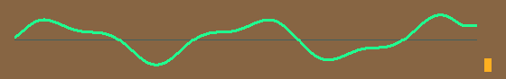

# 波形平滑与 KEY2 循环修复（2026-10-03）

## 需求与诊断

| 用户反馈 | 源码证据 | 处理 |
|---|---|---|
| 峰谷尖锐且跳动 | 旧显示是折线；完整32点采样组约80ms更新一次，空间插值不能提高时间更新频率 | 三次 B 样条 + 每个 VS 的 Q4 平滑 |
| 多次 KEY2 后停住 | 原完成条件 source_done_seen&&write_finish_pulse 会丢同拍/早到一次性完成事件 | 两端完成事件分别锁存，均到齐才提交 |
| 实际视频仍绕过安全门 | 顶层直接同步scaler完成，可能源失败前先转场 | 视频改用管理器成功toggle，同拍锁住SD pending |
| 连按被合并 | 原 next_req_pending 只能记住一项待处理请求 | 8位饱和待请求计数 |
| 临时失败无法恢复 | failed_mask 仅扫描复位清除，全坏时 manual_start 永远不满足 | 新手动按键开启一次重试 |
| 只有当前图可用却跳到坏图0 | next_good_index 默认0，漏了当前图的回退 | 无其他候选时选择真实可用图 |
| 旧完成被重试继承 | 错误后旧scaler仍可能运行、迟到done被下次当成功 | 本次新源写应答+解析成功+写完后才启动scaler，失败源禁止启动 |
| 失败后下一图混入半像素 | packer没有事务开始/错误清理入口 | source_restart 优先清除半字和行计数 |
| 非整突发尺寸永远忙 | writer等待完整BURST，尾部数据不足 | 尾突发长度取 min(剩余字数,BURST_SIZE) |

这些是源码反例与仿真证据。当前三张640×480图片的板测实际失效路径尚未确定；该尺寸的源字数恰为256整数倍，不触发短尾缺陷。

## “缓存255次”与图号循环

| 变量 | 语义 | 行为 |
|---|---|---|
| img_idx | 当前显示图片编号 | 三图0→1→2→0，累计次数不限 |
| next_req_count | 尚未启动的手动请求数 | 按键加1，启动减1；同拍一加一减保持；255时饱和 |

不能到上限就清零：如果转场期间已经积压15个未执行请求，清零会把这些请求直接丢弃。请求处理完自然归零，后续按键继续计数。255表示积压上限，满时额外请求不会新增；不是总共只能切255次。大量连按会带来排队等待，等待时间取决于读卡、缩放与转场耗时。

## 缩放事务隔离

`source_scaler_gate`以本次新源写请求应答建立事务边界，头部解析期间的旧源写完成不继承。源解析成功与本次源SDRAM写完均到达才翻转缩放启动事件；错误/重新装载/SD取消优先撤销本次门。错误源不产生缩放启动，避免旧scaler晚完成污染重试。事件toggle仅全局reset清零，不能因SD重初始化产生伪下降沿启动。

## 老师资料与实现

- 第十二讲 promax_audio_waveform.v：真实PCM valid、32点双bank、完整组VS发布和峰值条。保留DECIMATE=120及跨帧采集。
- 第十讲 frame_blend.v：帧同步转场、双页所有权及交叉混合。现有横推/淡化方案继续使用。
- 新增显示端平滑：节点以1/16像素定点保存，每VS向当前完整组目标推进误差的1/4；收敛后约有小于1/4像素的舍入残差。
- 三次均匀B样条用于圆润峰谷，内部节点数学上二阶连续；整数像素栅格和末段保持不等于无限分辨率曲线。使用真实PCM，音频内容不同不会总呈固定正弦。
- VS消隐期先更新32点，再经三拍Horner流水生成每列上下界，正常512列最多550拍，640列最多678拍。同步RAM查表和输入RGB/坐标同拍寄存，替代顶层原waveform_q拍，保留原输出相位。
- TD对两处曲线表写入展开寄存器，第一次重构超限；现使用单写端口EG_LOGIC_BRAM。SIMULATION模型保持相同同步读时序，物理IP仍需板测。

## 验证

| 范围 | 证据 |
|---|---|
| 按键管理器 | 678次提交、20次物理按下/释放、255饱和/排空后继续、源先/写先/同拍、错误同拍优先、全坏图重试、唯一好图回退 |
| 波形 | 1/16/20列采样间距、5920列曲线边界、独立B样条数学参考、逐帧单调收敛、满幅范围、显示期间稳定、实际像素连通 |
| 源写尾部 | 1/16/17/31/129字、逐字地址/总数、读占用互斥、后续装载 |
| 打包 | 已有格式/奇数行/多行用例，新增失败留半像素后重启 |
| 缩放启动门 | 新写请求/ACK边界、延迟ACK、旧ACK回低、旧writer完成拒绝、ACK和完成同拍、错误优先及SD deinit历史保持 |
| 顶层提交联合 | 真实gate+manager+提取顶层CDC，11次成功提交/11次缩放启动，失败零提交，2次重试，头部旧writer迟到不启动 |
| 顶层真实缩放 | 640×480、320×240、640×480三次源事务与页交替，每次307200目标像素，逐像素地址与恒等缩放色彩检查 |
| 顶层相位 | 提取真实顶层连接，1280个编码像素及两个行尾对齐 |

### 最终构建与回归

| 项目 | 最终结果 |
|---|---|
| 基础回归 | `bash scripts/regression.sh`，44/44，退出0 |
| 全量回归 | 基础通过后运行 `bash scripts/regression.sh --full`，45/45，退出0；当前源码再次综合、布线、hold修复及bitgen |
| 独立报告 | 全量结束后 `python -X utf8 scripts/check_reports.py`，fails=0 |
| 一致性 | 当前RTL、canonical .al、syn/phy工程快照、manifest及bit一致 |
| 当前bit | 2026-10-03 16:24:20；643592字节；SHA-256 `b874b41ebc302b72b0fd8c24f1cde372d61a36117e9fbb6705f3f5fa14f60de7` |
| 资源 | LUT15781/19600=80.52%；BRAM9K49/64=76.56%；DSP20/29 |
| 时序 | SWNS=-6.565ns、STNS=-1009.509ns、HWNS=+0.022ns、HTNS=0；setup仍有负余量，按既有基线门限通过 |
| 最终审查 | 两项P1已关闭：成功提交门和源事务缩放启动隔离；反例及限制保留在验证审查记录 |
| 验证记录 | [基础](validation/smooth-key-20261003/basic.log)、[全量](validation/smooth-key-20261003/full.log)、[独立报告](validation/smooth-key-20261003/reports.log)、[构建指纹](validation/smooth-key-20261003/build.json)、[审查](validation/smooth-key-20261003/review.md) |
| 板级 | 本轮尚未下载实测，连续按键与曲线观感待验证 |

提交前另发现两个新增文件末尾空行；规范后重新构建，再运行本表基础、全量及独立报告全部通过。回归首次遇到新联合测试的Icarus参数顺序错误，修正 `-s` 置于源文件前后重新运行上述两套回归通过；没有运行编译失败留下的旧vvp作为通过证据。显式事务门要求restart后至少有请求低的空闲拍，BMP重读头/校验提供该间隔。顺序装载协议保证源成功后不再产生同一源错误；行为模型不能证明突发断卡/物理刷新/加密IP。

## 备份与恢复

| 项目 | 位置 |
|---|---|
| 修改前提交 | bcece2b7fca392fbb8dacd1d61d5d574c00846e4 |
| Git恢复tag | backup/pre-smooth-key-20261003 |
| 旧bit与工程 | D:/FPGA/backups/pre-smooth-key-20261003/av_media.bit、av_media.al |
| 完整历史bundle | D:/FPGA/backups/pre-smooth-key-20261003/example-before-smooth.bundle，git bundle verify已通过 |

要恢复源码请把恢复tag检出到另一个目录，避免覆盖未保存修改；旧bit备份从已提交Git基线提取。不能将本轮失败或重建产物当成旧稳定固件。

## 板级复核

| 步骤 | 观察 |
|---|---|
| 下载当前 bit | 仍打开D:/FPGA/code/example/td_prj/av_media.al，下载phy_1/av_media.bit |
| 同一TF卡/WAV | 保留三张图和此前兼容音频，不需重新转格式 |
| 波形20秒 | 峰谷是否更圆、每帧变化是否顺滑、音频是否正常 |
| KEY2逐次40次以上 | 图号继续循环，无永久停止、黑闪或残留 |
| 转场中连按5次 | 当前动画不中断，随后顺序处理请求，最终还可继续切图 |
| 两路和应急 | 复核HDMI_A监视、HDMI_B图片、KEY4应急和复位 |
| 若再失效 | 保持现场，记录最后一次切图前后、HDMI_A完整状态和数码管；据状态区分load忙/failed_mask/显示hold |

当前setup仍有负余量，报告只按既有基线验收；没有宣称全部路径闭合。加密HDMI/SDRAM IP及真实刷新争用无法由行为模型证明，必须下载本轮bit确认。
